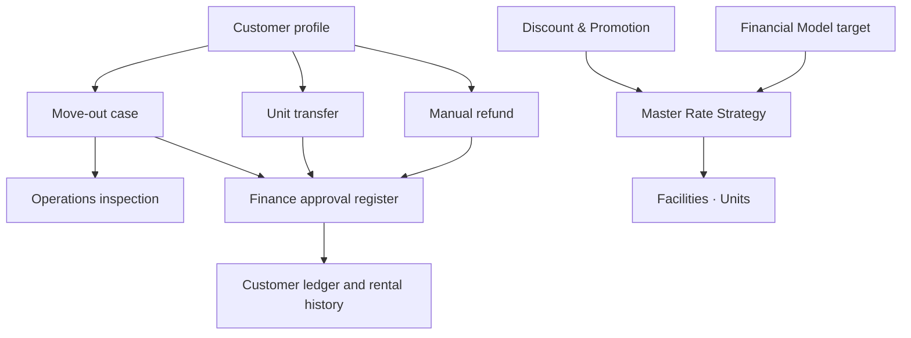
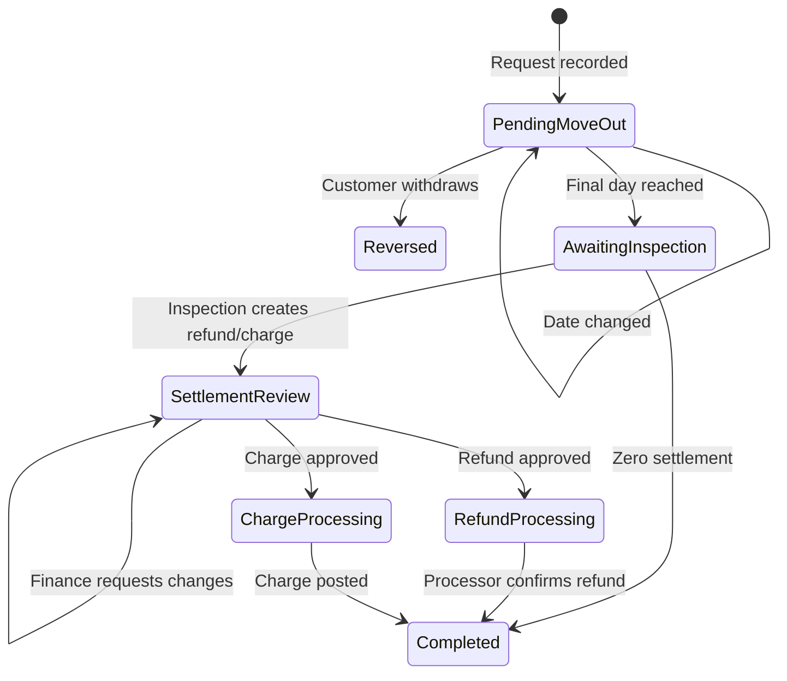

# StoreLah CRM — Developer Handoff

## Customer refunds, unit transfers, move-outs and Master Rate Strategy

**Handoff date:** 18 November 2026  
**Prototype release:** Version 55  
**Source commit:** `d24e105cc2d6e8adb0edefbe57526dcaa37239ff`  
**Live prototype:** <https://storelah-crm-leads.faisal-0213.chatgpt.site/?release=55>  
**Scope:** Customer Management, Operations, Finance Management, Facilities Management, Discount & Promotion and Global Settings.

---

## 1. Purpose and implementation rule

This document is the implementation contract for the recent StoreLah prototype changes covering:

1. Customer move-out requests and move-out status management.
2. Move-out date changes, inspections and final settlement.
3. Manual refunds for non-move-out reasons.
4. Unit transfers, Finance approval, correction and posting.
5. Customer ledger, rental-history and cross-module updates created by those workflows.
6. The Facilities **Master rate strategy** used to generate unit rack rates, preview promotions, compare Effective PSF with the approved Financial Model target, obtain approval and schedule rates into Facilities · Units.

This is an enhancement to the existing StoreLah CRM. Do not create standalone refund, transfer, move-out or pricing applications. Reuse the existing customer, unit, agreement, billing, promotion, Financial Model, approval, access and audit records.

### Non-negotiable implementation principles

- One customer may have several units. Status, billing, transfer and move-out are controlled per rental/unit; the customer-level status is derived.
- A request is not the same as approval, and approval is not the same as money movement or posting.
- Move-out rent refunds are calculated from the inspected move-out case. They must not be manually re-created in a separate refund tool.
- Manual refunds are for duplicate payments, overcharges, incorrect deductions, billing corrections, service recovery and documented exceptions.
- Only storage rent is prorated for a move-out. The Protection Plan paid for that month is never refunded or prorated.
- Unit transfers use one inclusive effective-day period for both the source-unit credit and destination-unit charge.
- A transfer must not change the active unit, access or recurring billing until Finance approves and posts it.
- Rack rates are owned by Master Rate Strategy. Promotions remain owned by Discount & Promotion. The Financial Model target is a read-only benchmark.
- Applying a rate strategy changes vacant-unit rack rates and future quotes/reservations from the effective date. It must not rewrite existing customer rent, signed agreements, Protection Plans or promotion definitions.
- All monetary values are SGD and must use decimal/cents-safe arithmetic. Do not use floating-point values as the production ledger source of truth.
- Every status, date, amount, approval, change request, correction, override and processor result must have an immutable audit entry.

---

## 2. Change summary

### Customer Management and Operations

- **NEW** — Customer rental status editor with per-unit status and mandatory reason.
- **NEW** — `Pending move-out`, `Awaiting inspection`, `Settlement review`, `Refund processing`, `Charge processing`, `Completed` and `Reversed` move-out workflow states.
- **NEW** — Customer profile **Move-out & transfers** workspace.
- **NEW** — Central **Move-out notices** register and Operations move-out queue.
- **NEW** — Move-out date-change flow with before/after refund preview and retained history.
- **NEW** — Required physical inspection before a move-out settlement can be submitted to Finance.
- **CHANGED** — Former customers retain rental history, transfer history, documents and ledger access; they no longer show an active unit or future deduction for the ended rental.
- **CHANGED** — Customer profile buttons now use explicit names such as **Record move-out request** rather than the ambiguous **Record request**.
- **NEW** — Transfer history displays source unit, destination unit, tenure, pricing, Protection Plan, deposit, billed values and source-unit credit.
- **NEW** — Finance change requests for transfers create a visible Operations work item and customer-timeline entry.

### Finance Management

- **NEW** — One canonical **Transactions, documents & approvals** register for invoices, receipts, refunds, charges, adjustments and transfer approvals.
- **NEW** — Manual refund request with approval, request-changes, correction, reapproval and processing stages.
- **NEW** — Inspected move-out settlement can resolve to a refund, an additional charge or zero settlement.
- **NEW** — Separate Finance approval and processor/posting actions.
- **CHANGED** — Processed refunds and posted charges appear in the customer ledger; pending requests remain visible but do not imply money moved.
- **CHANGED** — Posted transfers create explicit source and destination ledger lines and update rental history atomically.
- **CHANGED** — The old Credits page is labelled **Credits ledger (WIP)**. Refunds are not managed there.

### Global Settings

- **NEW** — **Move-outs & refunds** settings for advance notice, date-change permission, short-notice deposit treatment and approval role.
- **NEW** — Default 30-calendar-day notice rule.
- **NEW** — Explicit statement that payments run on the first, unused rent uses actual calendar days and the Protection Plan is retained.

### Facilities Management — Master Rate Strategy

- **NEW** — Administrator-only **Master rate strategy** under Facilities Management.
- **NEW** — Smooth size curve and Excel-style step-down pricing methods.
- **NEW** — Facility anchor rate, overall and category PSF floors, minimum rent, locker/ground-floor/restricted-access/facility adjustments and rounding controls.
- **NEW** — Exact rates generated for every whole square foot from 8 to 150 sq ft, while facility totals use only stocked sizes.
- **NEW** — Size categories, live PSF ranges, NLA, unit counts, weighted averages and total rent potential.
- **NEW** — Storage-duration filters for 1, 3, 6 and 12 months on the summary, live chart, category table, duration cards and unit-rate table.
- **NEW** — Read-only preview of Active promotions and selectable Draft test plans from Discount & Promotion.
- **NEW** — Separate Rack PSF, recurring Effective PSF and free-month Blended PSF.
- **CHANGED** — Financial Model comparison uses recurring Effective PSF, never Blended PSF.
- **NEW** — Validation, administrator warning override, Commercial/Finance approval, strategy library, facility duplication and scheduled application to Facilities · Units.

---

## 3. Navigation, route and source map

The application uses a page hash plus an internal panel/tab identifier. Production routing may use a framework route, but these labels and destinations must remain recognizable.

| Capability | Sidebar / entry point | Tab or panel | Hash / internal ID | Primary prototype source |
|---|---|---|---|---|
| Customer profile | Customer Management → Customer list → open customer | Profile tabs | `#customer-profile` | `dist/crm-ux-v2.js`, `dist/moveout-refunds.js` |
| Customer move-out and transfer controls | Customer profile | `Move-out & transfers` / `movement` | `#customer-profile`, `data-v2-panel="movement"` | `dist/crm-ux-v2.js`, `dist/moveout-refunds.js` |
| Customer current and previous units | Customer profile | `Rental & pricing` / `rental` | `#customer-profile`, `data-v2-panel="rental"` | `dist/crm-ux-v2.js`, `dist/v29-request.js` |
| Customer ledger | Customer profile | `Billing & payments` / `billing` | `#customer-profile`, `data-v2-panel="billing"` | `dist/crm-ux-v2.js`, `dist/moveout-refunds.js` |
| Documents | Customer profile | `Documents` | `#customer-profile`, `data-v2-panel="documents"` | `dist/crm-ux-v2.js` |
| Operations queue | Customer Management → Move-ins & move-outs | `ops-moves` | `#operations` | `dist/crm-ux-v2.js`, `dist/moveout-refunds.js` |
| Full move-out register | Customer Management → Move-out notices | page | `#moveout-notices` | `dist/moveout-refunds.js` |
| Refunds, charges and transfer approvals | Finance Management → Transactions, documents & approvals | `bill-transactions` | `#billing` + panel `bill-transactions` | `dist/crm-ux-v2.js`, `dist/moveout-refunds.js` |
| Global move-out/refund rules | Global Settings → Move-outs & refunds | `settings-moveouts` | `#settings-moveouts` | `dist/moveout-refunds.js` |
| Master Rate Strategy | Facilities Management → Master rate strategy | `facility-rate-strategy` | `#facilities` + panel `facility-rate-strategy` | `dist/rate-strategy.js`, `dist/rate-strategy-engine.js` |
| Unit inventory / scheduled rates | Facilities Management → Unit map & floor plans | `facility-map` | `#facilities` + panel `facility-map` | base Facilities UI + `dist/rate-strategy.js` sync banner |
| Promotion source | Discount & Promotion | `promo-library`, `promo-discount-matrix`, `promo-free-months` | `#promotions` | base promotion UI + `dist/rate-strategy.js` readers |
| Approved pricing benchmark | Finance Management → Size mix & pricing | `bill-size-mix` | `#billing` + panel `bill-size-mix` | `dist/financial-model.js`, read by `dist/rate-strategy.js` |

### Required cross-module links



Required jump actions:

- Transfer submission confirmation → **Open Finance approval**.
- Finance change request → Operations **Finance change requests** queue and customer transfer timeline.
- Move-out workspace → **Open Finance approval** when a settlement exists.
- Move-out register → **Move-out policy**.
- Finance transaction record → linked customer profile.
- Previous-unit history → **Open transfer record** and **View historical ledger**.
- Master Rate Strategy → **Open Financial Model pricing**, **Open promotion library**, **Apply rates to Units**, **Open Units module** and **Strategy library**.
- Facilities · Units sync banner → **Open rate strategy**.

---

## 4. Roles and authority

The prototype shows role labels but does not securely enforce them. Production must enforce these rules on the server and in the UI.

| Action | Minimum role | Notes |
|---|---|---|
| Record or change move-out request | Customer Service / Operations / Administrator | Date change requires reason and policy permission. |
| Complete move-out inspection | Facility Operations / Administrator | All four checks and notes/evidence required. |
| Create manual refund request | Customer Service / Operations / Finance / Administrator | Request creation does not move money. |
| Request Finance changes | Finance / Administrator | Reason and assignment required; transfer requests also require category and due date. |
| Approve refund/charge | Configurable: `Administrator or Finance` or `Administrator only` | Read from Global Settings. |
| Process refund / post charge | Finance / Administrator with processor permission | Must be distinct from request submission; separation of duties is recommended. |
| Submit unit transfer | Operations / Customer Service / Administrator | Source remains active. |
| Approve and post transfer | Finance / Administrator | Must execute atomic posting. |
| Edit customer/rental status | Authorised Operations / Administrator | Mandatory reason; a status change alone cannot move money, end access or release a unit. |
| Open Master Rate Strategy | Administrator only in the prototype | Production may add Commercial editor/approver roles. |
| Edit/save rate-strategy draft | Administrator / Commercial pricing editor | Promotion definitions remain read-only. |
| Accept warnings and submit pricing | Administrator | Warning override requires acknowledgement and reason. |
| Approve rate strategy | Commercial/Finance approver | Separate from the draft editor where possible. |
| Apply approved rates to Units | Administrator / authorised pricing publisher | Only Approved/Active version with no unsaved changes. |

---

## 5. Shared status and colour contract

Use the existing StoreLah palette and semantic meaning consistently.

| Meaning | Colour / token | Hex or current class | Examples |
|---|---|---|---|
| Successful, active, approved, posted | Warm sage / green | `.pill.green`: background `#dfeadf`, text `#3f6846` | Active, Approved, Posted, Refunded, Transferred |
| Pending, warning, action due | Amber | `.pill.amber`: background `#faebcf`, text `#8b6324` | Pending approval, inspection due, warning |
| Workflow review / informational | Warm blue | `.pill.blue`: background `#e1ebef`, text `#426676` | Settlement review, Pending approval strategy |
| Move-out / transferred emphasis | Dusty terracotta | `.pill.terra`: background `#f7e2d7`, text `#9a5031` | Transferred out, inspection state |
| Error / rejected / correction required | Red | `.pill.red`: background `#f8dfdc`, text `#9e3f38` | Failed, Rejected, open Finance correction |
| Draft, inactive, former, reversed | Neutral grey | `.pill.grey`: background `#edeae5`, text `#666` | Draft, Former rental, Reversed |

Move-out-specific classes:

- `Pending move-out` → amber (`mor-status pending`).
- `Awaiting inspection` → terracotta (`mor-status inspect`).
- `Settlement review`, `Refund processing`, `Charge processing` → blue (`mor-status review`).
- `Completed`, `Processed`, `Posted`, `Refunded`, `Approved`, `Transferred`, `Active` → sage green (`mor-status complete`).
- `Reversed`, `Cancelled` → grey (`mor-status reversed`).

---

## 6. Canonical records and identifiers

Production identifiers must be generated server-side, unique and immutable. Prototype patterns are:

- Move-out case: `MO-#######`
- Refund: `RF-#######`
- Additional charge: `CH-#######`
- Zero settlement/close record: `CL-#######`
- Unit transfer: `TRF-#######`
- Rate batch: `RATE-<timestamp>`

Do not infer record type only from the prefix. Persist `record_type` / `doc_type` explicitly.

### Prototype persistence keys

These are useful for locating the current implementation. They are not the production data architecture.

| Key | Prototype content | Production replacement |
|---|---|---|
| `storelahMoveoutCasesV31` | Move-out cases, date changes, inspection and case audit | Move-out case, inspection and audit tables |
| `storelahMoveoutPolicyV31` | Global notice/refund policy | Versioned global policy table |
| `storelahTransferApprovalsV2` | Transfers, refunds, charges and approval fields | Approval/financial transaction records plus type-specific tables |
| `storelahCustomerStatusesV31` | Per-unit and derived customer statuses | Rental status and immutable status-history tables |
| `storelahRateStrategyV1` | Working strategy, levers, selected previews, overrides and history | Rate strategy/version tables |
| `storelahUnitRackRatesV1` | Scheduled Units rate batch | Rate publication batch and batch lines |
| `storelahFinanceModelStateV2` | Approved/model price-mix state read by Rate Strategy | Financial Model version and approved target API |

---

## 7. Customer status management

### Where it lives

Customer Management → Customer list → open customer. The **Change status** button is in the customer hero. Status is stored per rental/unit and rolled up to the customer.

### Editable rental statuses

- Active
- Pending move-out
- Payment attention
- Access restricted
- Suspended
- Former customer

### Form fields

| Field | Type | Required | Rule |
|---|---|---:|---|
| Rental / unit | rental ID selector | Yes | Only units belonging to the customer. |
| New status | enum selector | Yes | Values listed above. |
| Reason for status change | long text | Yes | Must be saved in immutable audit history with actor and time. |

### Roll-up rule

For a multi-unit customer:

1. If every rental is `Former customer`, overall status is `Former customer`.
2. Else if any rental is `Active`, overall status is `Active`.
3. Else if any rental is `Pending move-out`, overall status is `Pending move-out`.
4. Else use the most relevant remaining controlled status.

The prototype blocks directly setting a multi-unit customer to `Former customer` while another rental remains active. Production should evaluate all rentals, not merely the number of customer units.

### Safeguard

Exact on-screen message:

> Use the move-out workflow to schedule dates and settlement. A status change alone never creates a refund, ends access or releases a unit.

This is a real business rule. Direct status editing must not bypass move-out, access or finance workflows.

---

## 8. Move-out workflow

### 8.1 Entry points

The same canonical flow must open from:

- Customer profile → **Move-out & transfers** → **Record move-out request**.
- Customer profile → **More actions** → **Record move-out notice**.
- Customer Management → **Move-out notices** → **＋ Record request**.
- Customer Management → **Move-ins & move-outs** → move-out queue.
- A linked customer-portal request, where the portal-provided date is prefilled and source/channel is `Customer portal`.

There must not be a competing move-out refund tool.

### 8.2 Initial request fields

| Field | Type / format | Required | Source / notes |
|---|---|---:|---|
| Customer | customer ID selector | Yes | Customer master. Prefilled when opened from profile. |
| Unit | rental/unit ID selector | Yes | Active rental units for customer. |
| Request received | `date` (`YYYY-MM-DD`) | Yes | Staff-entered or portal timestamp converted to Singapore date. |
| Customer’s final access day | `date` (`YYYY-MM-DD`) | Yes | Last billed/access day; access ends 11:59 PM. |
| Request channel | enum | Yes | Customer portal, WhatsApp, Phone, Email or Onsite. |
| Reason | enum | Yes | No longer needs storage, Price, Relocation completed, Transferred to another provider, Service issue or Other. |
| Customer message / staff note | text | Optional at request; recommended | Retained in case audit. |
| Monthly net storage rent | money | Read-only | Active rental billing schedule. |
| Protection Plan paid for month | money | Read-only | Active rental billing schedule. |
| Security deposit held | money | Read-only | Deposit ledger; currently S$0 launch policy. |

### 8.3 Request validation

- Customer, unit, request date and final access date are required.
- Final access date cannot be before request date.
- Notice is measured in calendar days, not business days.
- The request immediately changes that rental to `Pending move-out`, but does not release the unit or create a refund.
- If the final access date is today or in the past, case state is `Awaiting inspection`; otherwise `Pending move-out`.
- Current access remains valid through 11:59 PM on the final access date unless a separately authorised security action overrides it.

### 8.4 Notice calculation

```text
Notice days = final access date − request received date
Compliant = notice days ≥ configured required notice days
```

Default: **30 calendar days**.

Short notice may affect the refundable security deposit only if that policy is enabled. It does not reduce or remove the unused storage-rent refund. Security deposit collection is currently disabled at StoreLah launch, so the present value is S$0.

### 8.5 Move-out status state machine



State definitions:

| Status | Meaning | Customer/unit effect |
|---|---|---|
| Pending move-out | Request accepted; final day is in the future. | Rental and access remain active until final day. |
| Awaiting inspection | Final day has arrived/passed. | Unit is not available for a new customer until inspected. |
| Settlement review | Inspection produced a refund or charge awaiting Finance. | No money has moved. |
| Refund processing | Finance approved refund; processor confirmation pending. | Rental not fully closed until posting succeeds. |
| Charge processing | Finance approved an additional charge; posting/payment action pending. | Rental not fully closed until posting succeeds. |
| Completed | Access, inspection, settlement and unit release are complete. | Rental becomes former; no future deduction/access. |
| Reversed | Customer withdrew or request was entered in error. | Rental returns to Active; original history retained. |

### 8.6 Move-out workspace

The case workspace shows:

- Status.
- Unit and facility.
- Request date and channel.
- Final access date and 11:59 PM cut-off.
- Notice days and compliance.
- Inspection/release state.
- Settlement preview or final calculation.
- Audit timeline in reverse chronological order.

Actions are conditional:

- **Change move-out date** — only when Global Settings permits it and inspection is not complete.
- **Complete inspection** — only on or after final access day.
- **Reverse request** — only before inspection/completion.
- **Open Finance approval** — after a non-zero settlement record exists.

### 8.7 Changing the move-out date

Required fields:

- New final access day.
- Reason for date change.

Before saving, show a before/after comparison of:

- Previous and new final access dates.
- Previous and new estimated rent refund.
- Revised notice days and compliance.

On save:

- Recalculate notice compliance and settlement estimate.
- Recalculate access expiry, inspection scheduling and unit availability date.
- Preserve the previous date, new date, reason, actor and timestamp.
- Set status to `Awaiting inspection` if the revised date is today/past, otherwise `Pending move-out`.
- Keep Protection Plan refund at S$0.

Validation copy:

- `A reason is required to change the move-out date.`
- `The new date cannot be before the request date.`

### 8.8 Reversing a move-out request

Reversal requires a reason. It restores the rental status to Active, cancels scheduled access expiry/inspection tasks and retains the original case and dates in audit history. It must not delete the case.

### 8.9 Physical inspection

Inspection is mandatory. All four release checks must be checked:

1. **Unit is empty** — no goods, waste or customer locks remain.
2. **Door, lock, walls and floor checked** — evidence must be referenced for any charge.
3. **Access has been revoked** — customer and authorised-user credentials have ended.
4. **Unit release status confirmed**.

Unit release status enum:

- Ready for rental
- Cleaning required
- Maintenance required
- Blocked for investigation

Financial inspection fields, all SGD with two decimal places and minimum zero:

- Damage charge
- Cleaning charge
- Disposal charge
- Other charge
- Outstanding balance / arrears
- Approved special credit
- Inspection notes / evidence — required

Exact validations:

- `Complete all four release checks before submitting.`
- `Inspection notes or evidence are required.`

Submitting an inspection recalculates the settlement and may change the result from refund to additional charge. It then creates exactly one canonical Finance record unless the result is zero.

---

## 9. Move-out settlement calculation

### 9.1 Formula

The final access day is billed. Only days after it are unused.

```text
Days in month = actual calendar days in final-access month
Unused days = max(0, days in month − final-access day number)

Unused storage-rent refund
  = net monthly storage rent × unused days ÷ days in month

Deposit return
  = deposit held when notice is compliant
    OR when short-notice forfeiture is disabled
  = otherwise 0

Protection Plan refund = 0

Total charges
  = early termination
  + damage
  + cleaning
  + disposal
  + arrears
  + other approved charge

Net settlement
  = unused storage-rent refund
  + refundable deposit
  + approved special credit
  − total charges
```

Outcome:

- Positive → refund to customer.
- Negative → additional charge to customer.
- Zero → close without a processor instruction.

### 9.2 Worked example from the prototype

Final access: 15 November 2026  
Net monthly storage rent: S$661.50  
November days: 30  
Unused days: 15  
Cleaning charge: S$350.00  
Deposit: S$0.00  
Protection Plan refund: S$0.00

```text
Unused storage-rent refund = 661.50 × 15 ÷ 30 = S$330.75
Net settlement             = 330.75 − 350.00 = −S$19.25
Outcome                    = S$19.25 additional charge
```

### 9.3 Rounding and edge rules

- Use actual calendar days, including 28/29-day February and 31-day months.
- Round money to cents at each posted component and at the final result.
- Negative charge/credit input values must be rejected or clamped to zero; they must never increase a refund accidentally.
- Month-end move-out produces zero unused-rent refund.
- Exactly 30 days is compliant when the policy requires 30 days.
- A change in move-out date must recalculate every date-dependent component.
- Protection Plan refund remains zero in every move-out case.

---

## 10. Refund workflow

There are two refund origins but only one Finance approval and processing register.

### 10.1 Move-out refund

Origin: completed physical inspection on a move-out case.

Rules:

- The amount is system-calculated from the rental ledger and inspection inputs.
- Staff cannot bypass inspection by entering the same move-out refund manually.
- The Finance record links to `move_out_case_id` and contains the full calculation snapshot.
- A Finance correction recalculates the same case; it does not create an unrelated second refund.

### 10.2 Manual refund

Origin entry points:

- Customer profile → Billing & payments → **Start refund request**.
- Customer profile → More actions → **Transactions & documents**, then refund action.
- Finance Management → Transactions, documents & approvals → **＋ Manual refund**.
- Former customer/rental context remains selectable for legitimate historical billing refunds.

Use only for:

- Duplicate payment
- Overcharge
- Incorrect deduction
- Billing correction
- Service recovery
- Other documented exception

Move-out rent is not a manual-refund reason.

### 10.3 Manual refund fields

| Field | Type / format | Required | Rule |
|---|---|---:|---|
| Customer | customer ID | Yes | Active or former customer. |
| Unit / account | rental/unit ID or customer account | Yes | Preserve historical rental context when ended. |
| Source transaction / invoice | reference string | Conditional | Required for Duplicate payment, Overcharge, Incorrect deduction and Billing correction. |
| Refund reason | enum | Yes | Values listed above. |
| Refund amount | SGD decimal, minimum S$0.01 | Yes | Store as positive business amount; ledger direction is credit. |
| Return method | enum | Yes | Original payment method, Bank transfer or Customer account credit. |
| Reason, evidence and internal notes | long text | Yes | Explain cause, amount basis and evidence. |

Exact validation messages:

- `Enter a refund amount greater than zero.`
- `Notes and the refund basis are required.`
- `Link the source transaction or invoice for this billing refund.`

### 10.4 Submission behaviour

On **Submit for approval**:

- Create a Finance record with `doc_type = Refund`, `status = Pending approval`.
- Do not call the payment processor.
- Do not post a completed credit to the ledger.
- Retain the request as a pending ledger/approval reference where the UI shows pending records.
- Route to Finance → Transactions, documents & approvals and allow opening the new record.

Exact confirmation concept:

> `<refund ID> submitted for approval. No money has been sent.`

### 10.5 Finance review

The review drawer/modal must show:

- Customer and customer ID.
- Unit/account.
- Purpose/reason.
- Refund or charge amount.
- Return/charge method.
- Source transaction/invoice or move-out case.
- Status.
- Approver/owner.
- Processor reference.
- Approval role.
- Calculation breakdown for move-out settlements, or documented notes for a manual refund.

Pending actions:

- **Request changes**
- **Approve**

Approved actions:

- **Process refund** for refunds.
- **Post customer charge** for charges.

### 10.6 Requesting changes

For a manual refund or move-out settlement, Finance records:

- Correction required — mandatory text.
- Assign to — Operations requestor, Customer service or Facility team.
- Requested by and requested at.
- Status `Changes requested`.

No approval or processor instruction exists while the request is returned.

Manual-refund correction permits editing:

- Refund amount.
- Source transaction/invoice.
- Return method.
- Corrected reason, evidence and response.

Move-out-settlement correction permits editing:

- Damage, cleaning, disposal and other charges.
- Outstanding balance.
- Approved special credit.
- Inspection notes/evidence.

The corrected move-out settlement must be recalculated. It can change from refund to charge, charge to refund or either to zero.

On zero after correction:

- Cancel/close the pending Finance instruction.
- Do not call a processor.
- Complete the rental and mark it Former.

### 10.7 Approval and processing

Required lifecycle:

```text
Pending approval
    → Changes requested → corrected → Pending approval
    → Approved
    → Refunded / Posted
```

- Approval records approver, timestamp and decision.
- Approved refund shows `Approved; awaiting processor submission`.
- Processing calls the configured payment/refund provider or creates an authorised bank-transfer instruction.
- Mark `Refunded` only after provider confirmation.
- Store provider refund/payment reference, attempt status, failure reason and reconciliation link.
- A failed processor call leaves the request Approved or Processing; it must not appear as a completed customer credit.
- The processing endpoint must be idempotent. Retrying the same approval must not issue two refunds.

### 10.8 Customer ledger posting

For a completed refund, add one credit line:

| Ledger column | Value |
|---|---|
| Date | Processor-confirmed date/time in Singapore reporting timezone |
| Document | Refund ID, clickable |
| Unit | Linked rental/unit or customer account |
| Line item | `Refund · <category>` |
| Status | `Refunded` |
| Debit | `—` |
| Credit / payment | Positive absolute refund amount |

For an additional charge, add a debit line with `Additional charge · <category>` and status `Posted`.

Never use a negative displayed currency amount in the credit/payment column. Direction comes from the ledger column and entry type.

---

## 11. Unit transfer workflow

### 11.1 Entry points

- Customer profile → **Move-out & transfers** → **Preview transfer**.
- Customer profile → **More actions** → **Transfer unit**.
- A Finance change request can reopen the same transfer in the Operations correction workspace.

### 11.2 Transfer form

| Field | Type / format | Required | Source / rule |
|---|---|---:|---|
| Current unit | rental/unit selector | Yes | Customer’s active units only. |
| Current net monthly rent | SGD money | Read-only | Current rental pricing. |
| Transfer effective date | `date` | Yes | Drives actual-calendar-day proration. |
| Destination facility | facility ID | Yes | Inventory scope. |
| Destination unit | available unit ID | Yes | Exclude current unit and all units already active for the customer. |
| Destination gross monthly rent | SGD money | Read-only | Facilities · Units current approved rack rate. |
| Destination promotion | promotion reference | Read-only/derived | Destination eligibility takes precedence. |
| Destination net monthly rent | SGD money | Derived | Gross less applicable destination percentage promotion. |
| Destination Protection Plan | plan/price | Yes | Starts on destination schedule next billing cycle. |
| Current deposit held | SGD money | Read-only | Deposit ledger. |
| Destination deposit required | SGD money | Yes/derived | Currently S$0 launch policy. |
| Transfer reason | long text | Recommended; production should require | Upgrade, downsize, customer request, operational move, etc. |
| Posting rule | read-only | — | `Source remains active until Finance approval`. |

### 11.3 Transfer validation

- Source, destination and effective date are required.
- Destination must differ from source.
- Destination cannot already be active for the same customer.
- Destination must still be available when the server validates the request.
- One source rental cannot have more than one open transfer approval in `Pending approval` or `Changes requested`.
- Transfer calculation service must be available; never submit an uncalculated amount.
- Production must reserve/lock the destination during approval or define an expiry-and-revalidation rule.

### 11.4 Transfer calculation

The transfer effective day is included in both the source credit period and destination charge period. This deliberately produces an equal-day source credit and destination charge so the customer is not economically billed for two units for the same transfer period.

```text
Days in transfer month = actual calendar days
Transfer days = days in transfer month − transfer day + 1

Source unused-rent credit
  = source net monthly rent × transfer days ÷ days in transfer month

Destination prorated rent
  = destination net monthly rent × transfer days ÷ days in transfer month

Source deposit credit = deposit held on source rental

Deposit adjustment
  = destination deposit required − source deposit credit

Protection Plan adjustment = 0 under carry-forward treatment

Net transfer adjustment
  = destination prorated rent
  − source unused-rent credit
  + deposit adjustment
  + Protection Plan adjustment
  + approved exception adjustment
```

Outcome:

- Positive → amount due from customer.
- Negative → customer account credit.
- Zero → no financial adjustment, but approval is still required to post the unit change.

### 11.5 Worked example from the prototype

Transfer date: 20 November 2026  
November days: 30  
Transfer days: 11  
Source net monthly rent: S$547.20  
Destination net monthly rent: S$661.50

```text
Source credit             = 547.20 × 11 ÷ 30 = S$200.64
Destination prorated rent = 661.50 × 11 ÷ 30 = S$242.55
Net amount due            = 242.55 − 200.64 = S$41.91
```

### 11.6 Protection Plan rule

- The already-paid current month is carried forward.
- No mid-month Protection Plan credit.
- No duplicate destination charge for the same month.
- Destination plan/price becomes recurring at the next billing cycle.
- `Protection Plan adjustment` is therefore S$0 in the standard transfer calculation.

### 11.7 Submission

On **Submit to Finance**:

- Create a `Transfer approval` record with status `Pending approval`.
- Store a snapshot of every calculation input and output.
- Keep source unit, access and recurring billing unchanged.
- Show transfer in the customer’s transfer timeline as awaiting Finance.
- Make it searchable in Finance → Transactions, documents & approvals.
- Confirmation must offer **Return to customer** and **Open Finance approval**.

Required stored calculation snapshot:

- Source and destination unit IDs.
- Effective date.
- Days in month and transfer days.
- Source net monthly rent and source credit.
- Destination gross rent, promotion and net rent.
- Destination prorated rent.
- Source deposit credit, destination deposit and deposit adjustment.
- Destination Protection Plan and zero/carry-forward adjustment.
- Approved exception adjustment and reason, if any.
- Final net adjustment and outcome.

### 11.8 Finance approval

The Finance record shows the commercial record, calculation, status, owner, provider/posting evidence and audit history.

Finance actions:

- **Request changes**
- **Approve & post transfer**

Transfer approval and posting are intentionally one authorised atomic action in the prototype. If production separates approval and posting, the source unit must remain active until posting succeeds.

### 11.9 Finance request changes → Operations

Required Finance fields:

- Issue category:
  - Unit or transfer date
  - Pricing or promotion
  - Proration calculation
  - Security deposit
  - Protection Plan
  - Customer authorisation
  - Other
- Assign to:
  - Operations · named requestor
  - Operations · Facility team
  - Operations · Sales owner
- Due date.
- What Operations must correct — mandatory.

On save:

- Status becomes `Changes requested`.
- Processor/posting state becomes `Returned to Operations`.
- Create/update an Operations work item in Today, Move-ins & move-outs and the customer transfer timeline.
- Keep the source rental active.
- Dispatch the transaction-changed event or equivalent server notification.

### 11.10 Operations correction and resubmission

Operations sees:

- Finance category, reason, requestor and due date.
- Read-only customer and current/source unit.
- Editable transfer date.
- Editable destination unit, excluding the source and already-active units.
- Editable destination Protection Plan.
- Editable destination deposit.
- Mandatory Operations response/evidence.

Recalculate the entire transfer using corrected inputs. Do not allow staff to key the final net amount directly. Return the same transfer ID to `Pending approval`; retain the original request and response in its audit history.

### 11.11 Atomic posting requirements

When Finance approves/posts, one database transaction must:

1. Revalidate destination availability and active source rental.
2. Close the source unit schedule at the transfer effective date.
3. Mark the source unit as transferred out and make it available according to operational readiness rules.
4. Open the destination rental schedule.
5. Move the customer’s active-unit relationship from source to destination.
6. Update future recurring rent and Protection Plan to destination values.
7. Preserve original agreement and create a versioned transfer amendment/reference.
8. Post source credit, destination prorated rent, deposit lines and any exception to the ledger.
9. Create the previous-unit history record.
10. Write approver, timestamp, posting reference and audit events.

If any step fails, roll back all steps. Never show the new active unit without the corresponding billing and history entries.

### 11.12 Customer profile after posting

`Rental & pricing` must show:

- New unit as **Transferred in**.
- Previous unit and effective date.
- Transfer ID.
- Destination pricing, promotion, Protection Plan, deposit and commitment position.

`Previous units · transfer history` must retain:

- Previous/source unit and facility/level/size.
- `Transferred out` status.
- Destination unit.
- Transfer effective date and transfer ID.
- Rental period and tenure.
- Billing-period count.
- Gross and net monthly pricing and promotion.
- Protection Plan monthly value and billed total.
- Deposit held.
- Storage rent billed.
- Unused source-rent transfer credit.
- Net unit charges after transfer credit.
- Links to the Finance transfer record and historical ledger.

### 11.13 Transfer ledger lines

Pending transfer:

- One reference line: `Unit transfer adjustment · awaiting Finance approval`.
- Status is pending; this is not a completed ledger posting.

Posted transfer:

1. Source unit credit: `Unit closed · moved out (transferred to <destination>)` — status `Transferred`.
2. Destination debit: `Destination unit opened · prorated rent` — status `Active`.
3. Source deposit transfer credit, when non-zero.
4. Destination deposit debit, when non-zero.
5. Protection Plan line only when a non-zero approved adjustment exists; standard carry-forward is zero.

---

## 12. Finance transaction register contract

### Purpose

Finance Management → **Transactions, documents & approvals** is the canonical register for payment-related and approval records. Do not create a second refunds or transfer-approval register.

### Search and filters

- Search: ID, document, customer, unit, facility or payment method.
- Period: Month to date, Today, Last 7 days, Last month or Custom period.
- Custom start and end date.
- Facility.
- Unit type.
- Document type: Invoice, Refund, Charge, Credit note, Transfer approval or Adjustment.
- Status: include Pending approval, Approved, Changes requested, Paid, Failed, Posted, Refunded and Awaiting receipt as relevant.
- Sortable headings: date, ID, customer, document type, purpose, method, amount, status and approver/owner.

### Table columns

- Date
- Record ID
- Customer / unit
- Document
- Purpose
- Payment method
- Amount
- Status
- Approval / owner
- Action

Processor reference belongs in record detail, not as the primary table column.

### Empty state

Exact current copy:

> No records match these filters.

### Credits page boundary

The existing `bill-credits` panel is a future StoreLah Credits wallet/ledger. It must display that refunds are initiated from customer/move-out context and approved in Transactions. Do not put the refund workflow there.

---

## 13. Customer ledger, documents and activity integration

### Customer ledger

Every billed, credited, paid or refunded line must remain linked to:

- Customer ID.
- Rental/unit ID or customer-account context.
- Finance record ID.
- Source document/transaction.
- Amount and direction.
- Status.
- Posting/processor reference.
- Created, approved and posted timestamps.

The ledger should be append-only. Corrections use reversal/correcting entries rather than overwriting posted amounts.

### Documents

Refund, charge and transfer approval records are financial documents and must be discoverable from the customer Documents tab or **Open financial documents** action. They should not duplicate the underlying invoice, receipt or agreement file; store references.

### Notes and activity

Add human-readable events for:

- Move-out request created, date changed, reversed and inspected.
- Settlement submitted, returned, corrected, approved and processed.
- Manual refund submitted, returned, corrected, approved and processed.
- Transfer submitted, returned, corrected, approved and posted.
- Rental status changed.
- Rate strategy submitted/approved and rate batch scheduled/applied where relevant to units.

### Former customer behaviour

After all rentals end:

- Customer overall status is `Former customer`.
- Active unit count is zero.
- No future deduction is displayed for ended rentals.
- Access is inactive.
- Completed rental history remains visible.
- Documents and full ledger remain accessible.
- Manual refund against a historical transaction remains available.

---

## 14. Global Settings — Move-outs & refunds

### Where it lives

Global Settings → **Move-outs & refunds**, hash `#settings-moveouts`, panel `settings-moveouts`.

### Fields

| Setting | Type | Default | Behaviour |
|---|---|---:|---|
| Required advance notice | non-negative whole number of calendar days | 30 | Used by every facility unless a future facility override is approved. |
| Allow requested move-out date changes | boolean | On | Every change still requires a reason and recalculation. |
| Short notice may forfeit deposit | boolean | On | Affects deposit only, never unused storage rent. |
| Security deposit collection | boolean | Off/disabled in prototype | Authoritative source should be Fees & deposits settings. |
| Physical inspection required | boolean | On/locked | Required before settlement and release. |
| Approval role | enum | Administrator or Finance | Alternative: Administrator only. |

Validation:

- Notice days must be zero or more and are rounded to a whole number.
- Saving creates an audit entry with before/after policy, actor and timestamp.
- Existing cases should retain the policy version/snapshot used at request time, or the business must explicitly choose prospective recalculation. Do not silently alter historical outcomes when a global rule changes.

Exact explanatory rule:

> Payments run on the first of each month. After move-out, unused storage rent is calculated using actual calendar days. Protection Plan paid for the month is always retained and never prorated.

---

## 15. Facilities Management — Master Rate Strategy

### 15.1 Purpose and ownership

Master Rate Strategy creates a facility’s **rack rate** schedule. It does not own customer promotions and it does not overwrite the approved Financial Model.

Inputs come from:

- Facilities · Units — stocked sizes, unit counts, NLA and unit attributes.
- Discount & Promotion — approved percentage matrices, free-month plans, eligibility and stacking.
- Finance Financial Model — approved recurring customer Effective PSF target.

Outputs go to:

- Facilities · Units — approved future rack rates by size/unit.
- Future quotes and reservations — rates effective on/after publication date.
- Strategy library and audit history.

Existing signed customer rents are out of scope for a rate batch.

### 15.2 Location and access

Facilities Management → **Master rate strategy**, hash `#facilities`, internal panel `facility-rate-strategy`.

The page is labelled **Administrator only** in the prototype. Production can support Commercial pricing editors, but approval/publishing rights must be separated and server enforced.

### 15.3 Page structure and order

1. Page header and actions.
2. Target decision banner.
3. Facility/strategy context.
4. Base rack-rate KPIs and selected-duration promotion KPIs.
5. **Pricing workbench** with controls and live chart side by side.
6. **Size categories and live rate outcomes**, including duration filter and totals.
7. Attribute-adjusted examples and advanced guardrails.
8. **Discount & Promotion library** preview.
9. **PSF by customer storage duration** cards.
10. **Unit-rate breakdown** with duration filter, range view and overrides.
11. Version and change history.

Desktop keeps the chart beside the pricing levers and uses the available width. Mobile stacks sections, retains horizontal scrolling for dense tables/charts and keeps action labels readable.

### 15.4 Header actions

- **Strategy library**
- **Undo** — restores last saved state; disabled with no unsaved changes.
- **Save draft**
- **Duplicate for facility**
- **Validate strategy**
- **Apply rates to Units**
- **Send for approval**

Header status:

- `Unsaved changes`
- `Draft`
- `Pending approval`
- `Approved`
- `Active`

### 15.5 Strategy context fields

| Field | Type | Editable | Source / behaviour |
|---|---|---:|---|
| Facility | facility selector | Yes | Re-links to that facility’s Units inventory. |
| Strategy name | text | Yes | Facility/version identity. |
| Effective from | date | Yes | Used for approval version and rate batch. |
| Inventory source | summary | No | Facilities · Units; unit count and NLA. |
| Target source | PSF + model label | No | Approved Financial Model pricing target. |

The Financial Model target is a benchmark only. Rate Strategy must never write back and change it.

### 15.6 Base rack-rate KPIs

These do not change when another promotion/duration is previewed:

- Facility sizes — count of stocked size points.
- Rack rent potential — total monthly rent at 100% occupancy before promotions.
- Weighted rack PSF — total monthly rack rent divided by total facility NLA.

### 15.7 Promotion-preview KPIs

For the selected 1, 3, 6 or 12-month duration:

- Effective PSF after free period — recurring PSF after percentage discount.
- Blended PSF — shown only when applicable free months exist.
- Effective PSF vs target — recurring Effective PSF minus approved Financial Model target.

Free months must not change the target comparison.

### 15.8 Pricing workbench fields

| Field | Type / range | Default | Meaning |
|---|---|---:|---|
| Reference size | whole sq ft, minimum 1 | 10 | Anchor size used for starting rate. |
| Starting monthly rack rate | SGD, minimum 1 | S$90 | Pre-promotion monthly rate at reference size. |
| Pricing method | enum | Smooth size curve | `smooth` or `step`. |
| Curve strength | decimal slider 0–0.60 | 0.20 | How quickly PSF falls as size increases. Smooth only. |
| Reduce PSF every | whole sq ft, minimum 1 | 5 | Step interval. Step-down only. |
| PSF reduction per step | SGD, minimum 0 | S$0.20 | Fixed PSF decrease each interval. Step-down only. |
| Rack PSF floor | SGD/sq ft, minimum 0 | S$4.20 | Overall pre-promotion floor. |
| Minimum monthly rack rent | SGD, minimum 0 | S$45 | Final monthly minimum before rounding. |
| Locker unit adjustment | percentage −95% to +100% | −25% | Signed half-height locker factor. |
| Ground-floor adjustment | percentage −95% to +100% | +10% | Signed factor for tagged ground-floor/premium-access units. |
| Restricted-access adjustment | percentage −95% to +100% | −10% | Signed factor for tagged access limitations. |
| Facility-wide rate adjustment | percentage −50% to +100% | 0% | Facility positioning uplift/discount. |
| Round monthly rate to nearest | enum | S$1 | S$1, S$5 or S$10. |

Every field change recalculates chart, category table, duration cards, unit table, totals and validation. Any saved draft change invalidates prior validation.

### 15.9 Pricing methods

#### Smooth size curve

Simple explanation shown in the product:

> PSF falls gradually as size increases, giving every square foot a continuous rate. Best for a clean, consistent pricing curve.

Formula:

```text
Base PSF = starting monthly rack rate ÷ reference size

Raw smooth PSF(size)
  = Base PSF × (size ÷ reference size)^(−curve strength)
```

#### Excel-style step-down

Simple explanation shown in the product:

> PSF drops by a fixed amount after each size interval. Best when you want to mirror a traditional rate table.

Formula:

```text
Steps(size)
  = floor(max(0, size − reference size) ÷ step interval)

Raw step PSF(size)
  = Base PSF − Steps(size) × PSF reduction per step
```

#### Floors, attributes and final rack rate

```text
Pre-attribute PSF
  = max(raw method PSF, overall PSF floor, category PSF floor)

Base monthly rate = Pre-attribute PSF × unit size

Attribute-adjusted monthly rate
  = Base monthly rate
    × (1 + locker adjustment)             when half-height locker
    × (1 + ground-floor adjustment)       when tagged ground floor
    × (1 + restricted-access adjustment)  when tagged restricted
    × (1 + facility-wide adjustment)

Final rack monthly rate
  = round_to_increment(max(minimum monthly rent, attribute-adjusted monthly rate))

Final rack PSF = Final rack monthly rate ÷ unit size
```

Percentages are decimal multipliers in the formula; for example −25% is `−0.25`.

Production should store unit attributes independently and apply only those present on the unit. The attribute example cards isolate each factor; they do not imply every unit receives every factor.

### 15.10 Size categories

| Category | Range | Special rule |
|---|---|---|
| Locker | 8–15 sq ft | Half-height; overlaps XS by design and is selected by the locker attribute. |
| XS | 10–19 sq ft | Walk-in/non-locker. |
| S | 20–39 sq ft | Walk-in. |
| M | 40–69 sq ft | Walk-in. |
| L | 70–99 sq ft | Walk-in. |
| XL | 100–150 sq ft | Walk-in. |

The overlap is intentional. A 10 sq ft unit tagged `locker = true` is Locker; otherwise it is XS.

### 15.11 Exact-size schedule and facility inventory

- Generate a rate for every whole square foot from 8 to 150 sq ft.
- `Facility sizes only` shows size points stocked at that facility.
- `Every 1 sq ft` shows the full calculated schedule and allows `From`/`To` range filters.
- Only stocked sizes contribute to facility NLA, unit totals, weighted PSF and rent potential.
- Unstocked size/category rows show `Not stocked` or `Rate only` and must not affect totals.

Production inventory must come from Facilities · Units. The hard-coded sample facility inventories in the prototype are demo data, not business rules.

### 15.12 Size categories and live rate outcomes

The section contains a local but synchronised storage-duration filter:

- 1 mo
- 3 mo
- 6 mo
- 12 mo

Changing it updates:

- Live chart.
- Net/Effective PSF ranges by category.
- Monthly Net Rent Potential.
- Weighted-average Net/Effective PSF.
- Blended columns/totals when free months apply.
- Duration cards.
- Unit-rate breakdown.

The table columns are:

- Category
- Size range
- Facility NLA
- Units
- Rack PSF range
- Net PSF range
- Monthly Rack Potential
- Monthly Net Rent Potential

Totals below the table:

- Total facility NLA
- Total units
- Weighted-average Rack PSF
- Weighted-average Net/Effective PSF
- Weighted-average Blended PSF, only when free months apply
- Total monthly Rack Rent Potential
- Total monthly Net Rent Potential

Definitions:

```text
Total facility NLA = Σ(unit size × stocked-unit count)

Rack rent potential = Σ(rack monthly rate × stocked-unit count)

Net rent potential = Σ(recurring net monthly rent × stocked-unit count)

Weighted-average Rack PSF = Rack rent potential ÷ total facility NLA

Weighted-average Net/Effective PSF = Net rent potential ÷ total facility NLA

Weighted-average Blended PSF
  = Σ(blended monthly rent × stocked-unit count) ÷ total facility NLA
```

### 15.13 Discount & Promotion integration

Rate Strategy is a read-only analysis consumer of promotion records. It does not edit, approve, activate or publish a promotion.

Prototype library records:

| Plan | Status | Selectable in analysis | Treatment |
|---|---|---:|---|
| Longer Stay Plan · v4 | Active | Yes | Percentage matrix for 3, 6 and 12 months by size/access. |
| Stay 12, Pay 10 · v2 | Active | Yes | 12 months; two free months; eligible M/L/XL. |
| FESTIVE25 · v1 | Draft | Yes, preview only | 25% draft test. Selection does not approve or activate it. |
| BIRTHDAY30 · v2 | Active | No | Conditional customer offer; visible only. |
| LOYAL50 · v1 | Active | No | Conditional loyalty credit; excluded from recurring unit-rate analysis. |

The **Percentage matrix to preview** selector chooses `Standard unit` or `Premium access / ground floor`. This selects a Discount & Promotion matrix column only; it does not toggle the separate rack-rate ground-floor adjustment.

### 15.14 Percentage discount stacking

Multiple percentage discounts compound sequentially; they are not added.

```text
Combined discount = 1 − Π(1 − each discount)
```

Example: 20% followed by 10%:

```text
Combined = 1 − (0.80 × 0.90) = 28%, not 30%
```

### 15.15 Rack, Effective and Blended values

Business/UI terminology:

```text
Rack monthly rent = generated pre-promotion monthly price

Effective monthly rent
  = Rack monthly rent × (1 − approved combined percentage discount)

Effective PSF
  = Effective monthly rent ÷ unit size

Paid months = commitment months − eligible free months

Commitment rent
  = Effective monthly rent × paid months

Blended monthly rent
  = Commitment rent ÷ commitment months

Blended PSF
  = Blended monthly rent ÷ unit size
```

Important code-to-UI mapping in the current engine:

| Engine field | UI/business label |
|---|---|
| `rackMonthly`, `rackPsf` | Rack rent / Rack PSF |
| `netMonthly`, `netPsf` | Effective monthly rent / Effective PSF after percentage discount |
| `effectiveMonthly`, `effectivePsf` | Blended monthly rent / Blended PSF including free months |

When rebuilding the backend, use clear domain names and avoid preserving the confusing internal `effective*` name for blended values.

Blended PSF appears only when the selected duration and unit category receive free months. If no free months apply, do not draw a duplicate Blended line or show redundant Blended columns.

### 15.16 Worked rate example — 10 sq ft XS

Prototype defaults:

- Reference: 10 sq ft at S$90.
- Smooth curve; strength 0.20.
- 12-month standard percentage for 10 sq ft: 45%.
- XS is not eligible for Stay 12, Pay 10 free months.

```text
Rack monthly rent = S$90.00
Rack PSF          = 90 ÷ 10 = S$9.00
Effective rent    = 90 × (1 − 0.45) = S$49.50
Effective PSF     = 49.50 ÷ 10 = S$4.95
Blended PSF       = S$4.95 because no free month applies
```

### 15.17 Worked rate example — 40 sq ft M

Prototype defaults:

- 10 sq ft at S$90.
- Smooth curve strength 0.20.
- M category floor S$5.80.
- 12-month standard percentage for 40 sq ft: 42%.
- Two free months for M on a 12-month commitment.
- Round monthly rack rent to S$1.

```text
Raw PSF
  = 9.00 × (40 ÷ 10)^−0.20
  ≈ S$6.82

Rounded rack monthly rent = S$273.00
Displayed Rack PSF        = 273 ÷ 40 = S$6.83

Effective monthly rent
  = 273 × (1 − 0.42)
  = S$158.34

Effective PSF
  = 158.34 ÷ 40
  = S$3.96

Commitment rent
  = 158.34 × (12 − 2)
  = S$1,583.40

Blended monthly rent
  = 1,583.40 ÷ 12
  = S$131.95

Blended PSF
  = 131.95 ÷ 40
  = S$3.30
```

Target comparison uses **S$3.96 Effective PSF**, not S$3.30 Blended PSF.

### 15.18 Financial Model target

```text
Effective PSF gap
  = weighted-average recurring Effective PSF
  − approved Financial Model target PSF
```

The current prototype fallback target is S$5.64 for the Approved Sembawang Launch Plan v3. Production must read the latest explicitly approved model version for the selected facility and must not use a draft silently.

If below target, the page may solve for the approximate required anchor rate using a deterministic search, but the result is guidance only. It does not alter the model or strategy until the user changes/saves the draft.

### 15.19 Live chart

Chart series:

- Rack PSF — sage/dark green.
- Effective PSF — contrasting green/teal.
- Blended PSF — terracotta; only when free months apply.
- Approved Financial Model target — dashed neutral/brass line.

Axes:

- X: commercial size range 8–150 sq ft.
- Y: PSF values using S$0.50 tick intervals.
- Facility-size view shows points only for stocked sizes but keeps the full commercial axis.
- `Every 1 sq ft` view may draw the continuous calculated line, with stocked-size points emphasised.

Chart points provide unit size, PSF and monthly rent in accessible titles/tooltips. The chart is not intended to be draggable; values change through pricing inputs, promotion selection and duration filters.

### 15.20 Unit-rate breakdown

Required columns:

- Facility availability
- Category
- Unit size
- Promotion(s) applied
- Rack rent
- Rack PSF
- Approved discount
- Effective monthly rent
- Effective PSF
- Approved free months — only when applicable
- Blended monthly rent — only when applicable
- Blended PSF — only when applicable
- Model target PSF
- Effective PSF vs target
- Override

The table supports facility sizes only or every square foot with From/To filters. It includes its own synchronised 1/3/6/12-month duration filter.

### 15.21 Manual rate override

An override applies to one size point in the strategy draft.

Fields:

- Monthly rack-rate override — positive SGD.
- Reason — mandatory.

Actions:

- **Apply override**
- **Use generated rate** — removes override.
- **Cancel**

The override remains visible and auditable. It must still comply with the overall/category PSF floor; a below-floor override is a blocker.

### 15.22 Advanced guardrails

Category-specific minimum rack PSF fields use S$0.05 steps. The higher of the overall floor and category floor applies before rounding.

Current defaults:

| Category | Minimum Rack PSF |
|---|---:|
| Locker | S$7.00 |
| XS | S$7.00 |
| S | S$6.50 |
| M | S$5.80 |
| L | S$5.00 |
| XL | S$4.20 |

Other guardrails:

- Check total-rate progression so a larger unit does not accidentally have a lower total monthly rent than a smaller unit.
- Financial Model is benchmark-only.
- Promotion records remain separately controlled.

### 15.23 Strategy validation

Blockers prevent approval submission:

- No available facility sizes linked from Units.
- Starting monthly rack rate is not greater than zero.
- Negative overall floor.
- Stocked size breaches applicable rack PSF floor.

Warnings do not automatically block an authorised administrator:

- Larger unit total rent falls below a smaller unit.
- Percentage discount and free months are stacked.
- Weighted Effective PSF is below the approved model target.
- A Draft promotion is selected for preview.

Validation modal shows passed, warnings and blockers. Exact rule:

> Warnings do not block approval. An authorised approver can accept a warning with a note. Only red blockers prevent submission or approval.

### 15.24 Warning override and approval submission

If warnings exist, **Send for approval** requires:

- Administrator warning-override checkbox.
- Override reason — mandatory.
- Optional submission note.

Submission creates the next version, status `Pending approval`, with warning list, override reason, actor and timestamp in history. It does not apply rates to Units.

Commercial/Finance must approve the version before application.

### 15.25 Strategy library and facility duplication

Strategy library filters:

- Facility.
- Status: Draft, Pending approval, Approved or Active.

Each row shows strategy, facility, version, effective date, status, updated/owner and Load action.

Only Approved or Active strategies are eligible for Units application.

Duplication fields:

- Destination facility.
- Rate uplift percentage, default +5%.
- New strategy name.

Duplication copies pricing logic, not inventory. The destination facility re-links to its own Units inventory. Apply the uplift factor to:

- Starting monthly anchor rate.
- Overall PSF floor.
- Minimum monthly rent.
- Category floors.
- Size overrides.

Reset to version 1, Draft, unvalidated and preserve the origin facility/version in history.

### 15.26 Apply rates to Facilities · Units

The action can open at any time to preview, but the confirmation button is enabled only when:

- Strategy status is Approved or Active.
- There are no unsaved changes.

Fields:

- Rates take effect — date.
- Existing manual unit rates conflict rule:
  - Preserve existing manual rates — recommended.
  - Replace manual rates with this strategy.
  - Cancel if any manual rate exists.

Batch updates:

- Vacant-unit rack rates.
- Future quotes.
- New reservations on/after effective date.

Batch does not update:

- Occupied-customer rent.
- Promotion definitions.
- Protection Plans.
- Existing signed agreements.

Store batch ID, strategy/version, facility, effective date, conflict rule, unit count, size count, creation actor/time and rate lines. Show a Facilities · Units banner with batch status and a link back to the strategy.

Production needs scheduled statuses such as `Scheduled`, `Applying`, `Applied`, `Partially failed`, `Failed` and `Cancelled`, with per-unit results and safe retry.

---

## 16. Data model for production

Field names below are recommended domain names. Adapt them to the existing StoreLah database naming convention, but preserve relationships and semantics.

### 16.1 Move-out tables

#### `move_out_case`

| Field | Type | Notes |
|---|---|---|
| `id` | UUID / stable ID | Display reference stored separately if needed. |
| `case_number` | string, unique | `MO-...` |
| `customer_id` | FK | Customer master. |
| `rental_id` | FK | Authoritative customer-unit agreement. |
| `unit_id` | FK | Snapshot/reference. |
| `facility_id` | FK | Facility. |
| `request_received_at` | timestamp with timezone | Preserve original portal/staff time. |
| `request_channel` | enum | portal/WhatsApp/phone/email/onsite. |
| `reason_code` | enum | Business reason. |
| `request_notes` | text | Customer/staff message. |
| `final_access_at` | timestamp with timezone | End of selected date, Singapore facility timezone. |
| `notice_days` | integer | Calculated snapshot. |
| `notice_required_days` | integer | Policy snapshot. |
| `notice_compliant` | boolean | Calculated snapshot. |
| `status` | enum | State machine above. |
| `policy_version_id` | FK | Prevent historical policy drift. |
| `inspection_id` | FK nullable | Created on inspection. |
| `settlement_transaction_id` | FK nullable | Finance refund/charge record. |
| `created_by`, `created_at`, `updated_at` | audit | Server values. |

#### `move_out_date_change`

`case_id`, previous date, new date, reason, requested_by/customer indicator, actor, created time and recalculation snapshot.

#### `move_out_inspection`

Check booleans, release status, damage/cleaning/disposal/other charges, arrears, special credit, evidence references, notes, inspector and completion timestamp.

#### `move_out_settlement_snapshot`

Store month days, unused days, monthly rent, unused-rent refund, Protection Plan paid/refund, deposit held/return, each charge, credits, total and outcome. This snapshot must be immutable once approved; corrections create a new version.

### 16.2 Finance/refund tables

#### `financial_approval_record`

Common fields: ID/reference, type, customer, rental, unit, facility, source record, amount, currency, direction, method, category, status, requestor, approver, notes, processor reference, timestamps and idempotency key.

#### `refund_request`

Reason code, source transaction/invoice, requested amount, approved amount, return method, evidence, origin (`manual` or `move_out`), move-out link when applicable and lifecycle status.

#### `approval_change_request`

Approval record, category, reason, assigned team/user, due date, requested by/at, response, responded by/at and status.

#### `processor_attempt`

Approval/refund ID, idempotency key, provider, provider reference, attempt number, request amount, status, error code/message, raw provider-event reference, attempted/confirmed time and reconciliation status.

#### `ledger_entry`

Append-only double-entry-compatible record with account, customer, rental/unit, document, entry type, debit/credit amount, currency, posting date, reversal link and source approval.

### 16.3 Transfer tables

#### `unit_transfer`

Customer, source rental/unit, destination unit/facility, effective date, source/destination pricing snapshot, promotion snapshot, deposit snapshot, Protection Plan snapshot, calculation components, net outcome, status, approval record, change-request link, amendment document, posting reference and audit timestamps.

#### `rental_unit_history`

Customer/rental, unit, started/ended dates, end reason (`transfer`, `move_out`), replacement rental/unit, pricing/promotion snapshot, billed totals, transfer credit, source record and immutable audit reference.

### 16.4 Rate-strategy tables

#### `rate_strategy`

Strategy identity, facility, name, owner and current version reference.

#### `rate_strategy_version`

Version number, status, effective date, base size/rate, pricing method, curve/step settings, floors, minimum rent, adjustments, rounding, Financial Model target version, created/submitted/approved actors and timestamps.

#### `rate_strategy_category_floor`

Version, category, minimum rack PSF.

#### `rate_strategy_size_override`

Version, whole-sq-ft size, monthly override, reason, actor/time.

#### `rate_strategy_preview_selection`

Version/draft, promotion version references, selected preview duration and access matrix. This is analytical metadata; it does not activate a promotion.

#### `unit_rate_batch`

Batch ID, strategy version, facility, effective date, conflict rule, status, counts, created/approved/applied actors and timestamps.

#### `unit_rate_batch_line`

Batch, unit/size, previous rack, proposed rack, final outcome, conflict reason and applied timestamp.

---

## 17. Service/API contract

Use the existing StoreLah service architecture. The following operations describe required boundaries, not mandatory URL naming.

### Move-outs

- Create move-out case.
- Get/list/filter move-out cases.
- Change final access date with reason and optimistic concurrency/version.
- Reverse request with reason.
- Submit inspection and settlement inputs.
- Recalculate preview without posting.
- Submit/correct settlement to Finance.

### Refunds/approvals

- Create manual refund request.
- Get/filter approval register.
- Request changes.
- Correct and resubmit.
- Approve.
- Process refund/post charge with idempotency key.
- Receive processor webhook and reconcile.

### Transfers

- Preview transfer calculation from authoritative source/destination records.
- Submit transfer approval.
- Request Operations changes.
- Correct/resubmit transfer.
- Approve and atomically post transfer.

### Rate Strategy

- Create/update draft.
- Preview generated rate schedule and promotion outcomes.
- Validate strategy.
- Submit approval with warning acknowledgement/reason.
- Approve/reject version.
- List/load strategy library.
- Duplicate to facility.
- Create/schedule unit-rate batch.
- Apply batch and return per-unit result.

### Server requirements

- Recalculate all material amounts server-side; never trust browser totals.
- Use version/ETag or optimistic locking for edits and approvals.
- Apply RBAC server-side.
- Use idempotency keys for Finance processing, transfer posting and rate batch application.
- Store immutable audit entries and provider webhook payload references.
- Use database transactions for ledger, rental/unit and posting changes.
- Return stable error codes plus plain-language messages.

---

## 18. Domain events and notifications

Recommended events:

| Event | Key consumers |
|---|---|
| `move_out.requested` | Customer profile, Operations queue, unit availability forecast, access scheduler |
| `move_out.date_changed` | Operations, access expiry, inspection schedule, settlement preview |
| `move_out.reversed` | Rental status, access, Operations tasks |
| `move_out.inspection_completed` | Finance approval, facility readiness/maintenance |
| `move_out.settlement_submitted` | Finance register, customer timeline |
| `refund.changes_requested` | Requestor/Operations task, customer timeline |
| `refund.approved` | Processor queue |
| `refund.processed` | Ledger, customer notification, reconciliation |
| `charge.posted` | Ledger, payment collection, customer notification |
| `transfer.submitted` | Finance register, customer timeline |
| `transfer.changes_requested` | Operations queue, customer timeline |
| `transfer.resubmitted` | Finance register |
| `transfer.posted` | Rental/unit master, ledger, documents, billing schedule, unit history |
| `rate_strategy.submitted` | Commercial/Finance approval queue |
| `rate_strategy.approved` | Pricing publisher notification |
| `unit_rate_batch.scheduled` | Facilities · Units banner, scheduled job |
| `unit_rate_batch.applied` | Units, quotes/reservations, strategy history |

Notifications must link to the exact record, not only the module home page.

---

## 19. Empty, loading and error states

The prototype is mostly synchronous. Production must add consistent loading and failure states without changing the business contract.

### Move-outs

- Empty register: `No move-out cases match these filters.`
- Customer profile with no active request: `No active move-out request` and explain that recording one marks only the selected rental Pending move-out.
- Loading: case/table skeleton; disable submit while calculating/saving.
- Calculation error: `Choose a valid request and move-out date.`
- Save failure: keep entered values, show retry, do not change displayed status.
- Inspection submit failure: no Finance record and no unit release until the server confirms the transaction.

### Refunds and Finance

- Empty register: `No records match these filters.`
- Processor failure: show Approved/Processing plus failure reason and Retry; never show Refunded.
- Duplicate submission: return existing record using idempotency key.
- Permission error: explain required role; do not merely hide server rejection.

### Transfers

- No active unit: `This customer has no active unit to transfer.`
- No destination: `No available destination units are configured.`
- Invalid same unit: `The destination unit must be different from the current unit.`
- Existing destination: `The destination is already active for this customer.`
- Existing open transfer: show the transfer ID and link to it.
- Destination conflict at approval: do not partially post; return conflict and route back for correction.

### Rate Strategy

- No inventory: `No facility sizes are linked yet.` This is a validation blocker.
- Strategy-library empty: `No strategies match these filters.`
- Units apply before approval: show preview, disable confirmation and explain approval requirement.
- Unit-rate batch partial failure: retain per-unit results and offer safe retry only for failed lines.
- Financial Model target unavailable: show a blocking or clearly labelled fallback state; production should not silently use sample S$5.64.
- Promotion service unavailable: retain rack-rate editing but label promotion outcomes unavailable and block commercial approval if target validation depends on them.

---

## 20. Audit requirements

Every audit entry should include:

- Record ID and version.
- Event type.
- Before and after values where applicable.
- Actor user ID, display name and role.
- Server timestamp.
- Reason/notes.
- Source channel/application.
- Related approval, processor, document or policy version.
- Correlation/request ID.

Never overwrite:

- Previous move-out dates.
- Returned Finance correction brief and Operations response.
- Previous transfer calculations.
- Previous strategy versions.
- Posted ledger entries.
- Processor attempts and webhook results.

---

## 21. Automated calculation tests

The prototype release passes 29 automated tests across move-out, transfer, rate-strategy and NPV modules. The following tests are mandatory for this scope.

### Move-out

1. Mid-month storage-rent-only refund.
2. Date-change recalculation.
3. Notice compliance controls deposit return without changing rent refund.
4. Charges can convert refund to additional charge.
5. Month-end produces no unused-rent refund.
6. Exactly 30 days is compliant.
7. February uses actual calendar days.
8. Negative inputs do not increase refund.
9. Invalid date rejected.

### Transfer

1. Effective day included in source and destination periods.
2. Actual calendar days used.
3. Source deposit offsets destination deposit.
4. Protection Plan carry-forward has zero mid-month adjustment.
5. Cheaper destination produces customer credit.
6. Same source/destination rejected.
7. Active destination rejected.
8. Duplicate open source transfer rejected.
9. Posting is atomic and idempotent.

### Master Rate Strategy

1. Every whole square foot receives a rate while facility totals use stocked sizes only.
2. Facility inventory reconciles to Units NLA and unit count.
3. Category boundaries and locker overlap work correctly.
4. Percentage discount changes Effective rent/PSF consistently.
5. Stacked percentages compound sequentially.
6. Free months blend evenly across commitment.
7. Free-month eligibility applies only to eligible categories.
8. Percentage plus free months use one cash-equivalent formula.
9. Required base-rate solver reaches model target.
10. Warnings do not silently block an authorised override; blockers do.
11. Category floors and manual override validation.
12. Locker and signed attribute factors.
13. Facility weighted averages reconcile to rent potential and NLA.
14. Target variance uses recurring Effective PSF, not Blended PSF.
15. Excel-style step-down respects interval and floor.
16. 1/3/6/12-month filters update all linked views consistently.
17. No Blended series/columns when free months do not apply.
18. Approved rate batch does not alter occupied customer agreements.

---

## 22. End-to-end acceptance scenarios

### Scenario A — compliant mid-month move-out refund

1. Record request at least 30 days ahead.
2. Verify unit shows Pending move-out and remains active.
3. Change the date; confirm before/after estimate and audit.
4. On/after final day, complete all four inspection checks with no charges.
5. Confirm refund record appears in Finance, customer ledger as pending reference and move-out case.
6. Finance approves; confirm no ledger credit is yet marked Refunded.
7. Finance processes; provider confirms.
8. Confirm ledger credit, processor reference, Former rental status, zero future deduction, access ended and unit release status.

### Scenario B — move-out defects exceed refund

1. Create a mid-month move-out.
2. Inspection adds cleaning/damage above rent refund.
3. Confirm settlement becomes a Charge.
4. Finance requests changes; Operations corrects evidence/amount and resubmits.
5. Finance approves/posts.
6. Confirm debit ledger entry and completed rental.

### Scenario C — manual overcharge refund

1. Start refund from customer ledger.
2. Choose Overcharge and omit source invoice; confirm validation blocks.
3. Add source, amount and notes; submit.
4. Confirm record in Finance and customer context.
5. Finance requests changes; requestor edits and resubmits.
6. Approve and process once.
7. Retry the processor call; confirm no duplicate refund.

### Scenario D — unit transfer with Finance correction

1. Preview transfer and verify source/destination proration.
2. Submit; confirm source remains active.
3. Finance requests a pricing/date correction with category, assignee and due date.
4. Confirm Operations queue and customer timeline show it.
5. Correct and resubmit; confirm same transfer ID and new calculation snapshot.
6. Finance approves/posts.
7. Confirm destination is active, source is in Previous units, next deduction is destination pricing and ledger contains source/destination lines.

### Scenario E — Master Rate Strategy to Units

1. Open Sembawang strategy and select 1, 3, 6 and 12 months.
2. Confirm chart, category table, totals, duration cards and unit table remain synchronised.
3. Select Active and Draft test promotions; confirm Draft is preview-only.
4. Create warning conditions; validate and submit using administrator override/reason.
5. Approve as Commercial/Finance.
6. Schedule Units rate batch preserving manual exceptions.
7. Confirm vacant unit rates/future quotes change on effective date and occupied customer rent does not.

---

## 23. Demo/sample data versus business rules

### Real business rules to preserve

- 30-calendar-day notice default.
- Move-out date may change with reason and recalculation when policy permits.
- Final access day is billed; only later days are unused.
- Only storage rent is prorated/refunded for move-out.
- Protection Plan is never refunded/prorated for that month.
- Physical inspection before settlement and unit release.
- Finance approval before refund/charge/transfer posting.
- Source unit remains active until transfer approval/posting.
- Destination pricing/promotion takes precedence in transfer.
- Transfer Protection Plan carries forward without duplicate mid-month charge.
- Per-rental status and derived customer status.
- Master Rate Strategy owns rack rates; Promotion owns discounts/free months; Financial Model is read-only target.
- Effective PSF, not Blended PSF, is compared with the recurring target.

### Prototype/demo data to replace

- Named sample customers, units and Finance users.
- Hard-coded Sembawang/Tampines/Central inventory arrays.
- Sample unit prices, promotions and plan versions.
- Fallback Financial Model target S$5.64.
- Browser-generated references and processor IDs.
- Hard-coded next deduction dates.
- Browser `localStorage` persistence.
- Simulated approval identity (`Finance Admin`, `Faisal`, `Nur Aisyah`).
- Hard-coded strategy-library records.

---

## 24. Production gaps and mandatory engineering work

The version 55 prototype demonstrates UI behaviour and cross-module data flow. It is not a production accounting implementation.

Before release, implement:

1. Server/database persistence instead of browser storage.
2. Server-side RBAC and separation of duties.
3. Decimal/cents-safe calculation service shared by preview and posting.
4. Database transactions for transfer/move-out/ledger posting.
5. Idempotency keys for processor calls and posting actions.
6. Payment-provider refund API, webhooks and reconciliation.
7. Immutable audit storage.
8. Optimistic locking/concurrency control.
9. Destination-unit reservation/revalidation during transfer approval.
10. Versioned policy snapshot for historical move-out cases.
11. File/evidence attachment service for inspections and refunds.
12. Notifications/tasks with exact deep links.
13. Effective-dated unit-rate publication job and per-unit results.
14. Approved Financial Model and promotion-version APIs.
15. Monitoring, structured logs and alerting for failed processor/posting/rate-batch operations.
16. Accessibility and responsive QA for all modals, dense tables and charts.
17. Export/report controls that apply the same server filters as the screen.
18. Migration/backfill plan for existing customers, rentals, ledger records, unit rates and historical transfers.

---

## 25. Source-file map

| File | Responsibility |
|---|---|
| `dist/moveout-engine.js` | Pure move-out date, notice and settlement calculations. |
| `dist/moveout-refunds.js` | Move-out register/workspace, inspections, policies, manual refunds, Finance review/correction/processing, status editor and ledger integration. |
| `dist/transfer-engine.js` | Pure transfer proration, deposit and Protection Plan calculation. |
| `dist/crm-ux-v2.js` | Customer profile, transfer UI, Finance transaction register, change-request queue, transfer posting and previous-unit presentation. |
| `dist/v29-request.js` | Supporting customer workflow/rental presentation and legacy bridge; production should consolidate canonical flows rather than keep competing implementations. |
| `dist/rate-strategy-engine.js` | Pure category, rack, promotion, weighted summary, required-base and validation calculations. |
| `dist/rate-strategy.js` | Master Rate Strategy UI, integrations, versioning, validation, approval, library, duplication and Units rate batch. |
| `dist/moveout-refunds.css` | Move-out/refund UI and semantic status colours. |
| `dist/rate-strategy.css` | Master Rate Strategy desktop/mobile layout, chart, tables and approval states. |
| `dist/index.html` | Base navigation, design tokens and module panels. |
| `tests/moveout-engine.test.js` | Move-out calculation tests. |
| `tests/transfer-engine.test.js` | Transfer calculation tests. |
| `tests/rate-strategy-engine.test.js` | Rate and promotion calculation tests. |
| `docs/refund-transfer-audit-2026-11-16.md` | Prototype audit evidence and corrected defects. |

Recommended consolidation: keep calculations in pure, independently tested domain services; keep one UI/controller per canonical workflow; remove or route legacy move-out/refund/transfer buttons into those services.

---

## 26. Open business/technical decisions

The following require confirmation before production lock:

1. Whether the 30-day notice policy is global only or may be overridden by facility/agreement.
2. Whether policy changes apply only to new cases or can recalculate open cases. Recommended: snapshot at request time and require an explicit authorised case override.
3. Whether short notice always forfeits the full deposit or can forfeit a configurable amount. Current rule is all-or-zero; deposits are presently disabled.
4. Whether early-termination charges are automated from commitment rules or entered/approved during inspection.
5. Who may approve their own refund/transfer request. Recommended: no self-approval above a configurable threshold.
6. Whether a transfer reserves the destination immediately, and for how long while Finance reviews it.
7. Whether a transfer requires a customer e-signature/amendment before Finance posting.
8. Whether a negative transfer adjustment is refunded to the payment method or retained as customer account credit. Prototype labels it customer account credit.
9. Exact payment provider and refund SLA/failure handling.
10. Accounting treatment and general-ledger accounts for refunds, move-out charges, transferred deposits and rate changes.
11. Whether the selected promotion preview is saved as part of the rate-strategy version or always recalculated from the latest promotion library. Recommended: save referenced promotion version IDs for reproducibility.
12. Whether rate batches update all vacant units or only currently marketable/ready units.
13. Manual-unit-rate conflict approval limits and who can choose `Replace manual rates`.
14. Approval thresholds for below-target Effective PSF, promotion stacking and large overrides.
15. Whether facility rack rates may exceed the current 8–150 sq ft commercial range in future. Production should avoid hard-coding the maximum.

---

## 27. Definition of done

This scope is complete only when:

- All buttons route to the canonical workflow and no legacy competing flow remains.
- Every request appears in the correct customer, Operations and Finance context.
- Calculations match independent examples and automated tests.
- Status transitions are server-enforced and audited.
- Refund/charge/transfer posting is atomic and idempotent.
- Customer ledger and rental history reconcile to Finance records.
- Former rentals have no future deductions or access.
- Master Rate Strategy duration filters update every linked view consistently.
- Effective versus Blended terminology is correct everywhere.
- Financial Model target and Promotion definitions are read-only integrations.
- Only approved, saved rate versions can update Units.
- Existing customer pricing is preserved by rate publication.
- Empty, loading, error and permission states are implemented.
- Desktop and mobile layouts have been tested.
- Migration, observability, reconciliation and rollback procedures are documented.

---

## 28. Quick implementation checklist for the AI development agent

- [ ] Inspect existing customer, rental, unit, billing, promotion, Financial Model and approval schemas before coding.
- [ ] Map existing identifiers to the canonical records in this document.
- [ ] Implement pure calculation services first and copy the automated examples.
- [ ] Implement server-side status machines and RBAC.
- [ ] Route all entry buttons to one move-out, one transfer and one refund flow.
- [ ] Add cross-module events/deep links.
- [ ] Implement ledger posting and provider idempotency.
- [ ] Implement customer rental history and former-rental behaviour.
- [ ] Implement Rate Strategy versioning, validation, warning override and approval.
- [ ] Read inventory from Units, promotions from Discount & Promotion and target from the approved Financial Model.
- [ ] Apply rates only through an effective-dated, auditable batch.
- [ ] Add unit/integration/E2E tests from Sections 21 and 22.
- [ ] Reconcile test postings and obtain Finance/Operations sign-off before production release.


