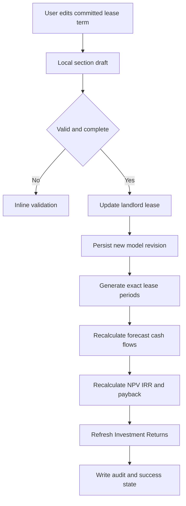

# StoreLah Lease Horizon Developer Handoff

**Modules:** Finance Management - Financial Models and Investment Returns  
**Prepared for:** StoreLah CRM development team  
**Specification date:** 9 November 2026  
**Prototype reference:** https://storelah-crm-leads.faisal-0213.chatgpt.site  
**Prototype version:** 36

## 1. Purpose and implementation decision

This handoff defines the production implementation of the **Committed lease term** control introduced under **Financial Models > Landlord lease**, and every downstream effect in **Investment Returns**.

The committed lease term is the signed, non-cancellable landlord lease period. It is the authoritative limit for the committed forecast and the unlevered project valuation. It must not be confused with the customer commitment period, a chart filter, a return-period selector, or an optional landlord renewal.

The field is editable only in **Landlord lease**. Investment Returns and Investment valuation assumptions display it as a read-only linked value with a shortcut back to Landlord lease. This gives the CRM one source of truth and prevents different screens from using different horizons.

### Production decision

The prototype stores an integer `horizon` in months. The actual CRM should preserve that input for usability but also derive and persist the contractual date boundary:

- `lease_start_date`
- `committed_term_months`
- `committed_end_date` derived as `lease_start_date + committed_term_months months - 1 day`

The valuation engine must calculate cash flows through the exact end date. If a lease begins mid-month, the first and final calendar months may both be partial periods. Do not implement the term as a fixed number of calendar rows when that would change the contractual duration.

Example: a 12-month lease beginning 15 December 2026 ends on 14 December 2027. The forecast contains a 17-day opening stub, eleven full calendar months, and a 14-day closing stub. Together they represent exactly 12 contractual months.

## 2. Scope

### Included

- Editable committed lease term under Financial Models > Landlord lease.
- Draft, Undo and Update behaviour for the Landlord lease section.
- Lease schedule expansion and contraction.
- Exact lease start and end date treatment, including mid-month dates.
- Recalculation of the monthly forecast and all Investment Returns outputs.
- Read-only horizon display and jump links in Investment valuation assumptions and Investment Returns.
- Persistence by facility and financial-model version or draft.
- Audit history, permissions, validation, concurrency and error states.
- Automated unit, integration and acceptance tests.

### Excluded

- Customer storage commitment periods.
- Automatic inclusion of unsigned landlord renewals.
- Assumed sale value for fit-out or property.
- Equity NPV unless financing cash flows exist.
- Changes to historical posted actuals.

## 3. Information architecture and routes

| Area | Sidebar and screen | UI location | Suggested route |
|---|---|---|---|
| Edit source | Finance Management > Financial Models | Section 4 Landlord lease | `/finance/models/:modelId?section=landlord-lease` |
| Linked display | Finance Management > Financial Models | Section 5 Investment valuation assumptions | `/finance/models/:modelId?section=valuation` |
| Valuation output | Finance Management > Investment Returns | Committed project valuation | `/finance/investment-returns?modelId=:modelId` |
| Audit | Finance Management > Model Library | Version and approval history | `/finance/model-library/:modelId/history` |

If the CRM uses hashes rather than path routing, retain the same semantic destinations. A jump action from Section 5 should scroll to Section 4, expand it if necessary and focus **Committed lease term**.

## 4. Financial Models user experience

### 4.1 Landlord lease section layout

Display the following order:

1. Section heading: **4. Landlord lease**
2. Supporting text: **The single source for lease term and lease expense throughout the model**
3. Section actions: **Undo** and **Update**
4. Summary: **Committed landlord lease**
5. Summary value: `{termMonths} months - {monthlyRent} per month`
6. **Committed lease term** input
7. **Lease commencement date** input, if not already inherited from the model's operational or lease start settings
8. **Usable floor area UFA**
9. **Rent-free period** or explicit rent-free dates
10. Editable landlord lease schedule by lease year
11. Data-lineage note explaining downstream effects

### 4.2 Committed lease term control

| Property | Requirement |
|---|---|
| Label | Committed lease term |
| Control | Numeric input with suffix `months` |
| Type | Whole integer |
| Prototype range | 12 to 120 months inclusive |
| Step | 1 month |
| Default for existing Sembawang model | 60 months |
| Required | Yes |
| Source of truth | Current facility financial-model version or draft |
| Editable by | Super Admin, Finance Admin; Finance Manager on a working draft |
| Read-only for | Operations, Sales, Viewer and approved models without an editable draft |

**Help text**

> The signed, non-cancellable landlord lease period. This controls the monthly forecast horizon and the committed cash flows used for Project NPV, IRR and payback. Any unsigned extension belongs in the separate renewal scenario.

### 4.3 Dirty state and section actions

- No change: **Undo** and **Update** are disabled.
- Input changed: show **Unsaved changes** beside the section subtitle; enable both buttons.
- **Undo** restores all uncommitted Landlord lease fields to the last committed model version. It must not affect other sections.
- **Update** validates and commits the entire Landlord lease section as one transaction.
- Updating this section saves to the currently loaded editable draft. It does not create a new draft.
- If an approved model is protected, the user must first use **Save as new draft** or **Duplicate**. Do not modify an approved model directly.
- The global **Save** action in the Financial Model must include the committed horizon in the full model snapshot.

### 4.4 Schedule behaviour

For a term of `N` months, show `ceil(N / 12)` lease-year rows.

Each row contains:

- Lease year
- Monthly landlord rent
- Implied UFA PSF
- Payable amount within the committed term
- Number of payable months or partial-period equivalent
- Basis or source of the amount

If the term ends partway through a lease year, the final row must include only the months and days within the committed term.

When the term is increased:

1. Add the required lease-year rows.
2. If a contractual rent is not available, prefill using the last entered rent or the configured escalation rule.
3. Mark prefilled rows as **Estimated - review required**.
4. Require user acknowledgement before Update. Production must not silently treat an inferred rent as contractual.

When the term is reduced:

1. Exclude later schedule rows from the committed calculation.
2. Preserve prior values in version history so re-extension or audit remains possible.
3. Do not delete historical actuals.
4. Block a reduction that ends before the latest posted actual period unless a Finance Admin follows an explicit model-rebase workflow.

### 4.5 Exact interface copy

**Validation error**

> Committed lease term must be between 12 and 120 months.

**Incomplete schedule error**

> Lease schedule is incomplete for the extended term. Review the estimated lease-year amounts before updating.

**Success toast**

> Landlord lease updated to {termMonths} months. Forecast horizon, NPV, IRR, payback, monthly lease and budgets are synced.

**Undo toast**

> Landlord lease changes undone.

**Recalculation loading state**

> Recalculating forecast and investment returns...

**Recalculation failure**

> The lease was saved, but investment returns could not be recalculated. Retry calculation or contact Finance support.

**Concurrency conflict**

> This model was changed by another user. Reload the latest version before updating.

### 4.6 Linked value in Investment valuation assumptions

Display a read-only summary card:

- Label: **Committed valuation horizon**
- Value: `{termMonths} months`
- Tooltip: **The signed landlord lease term. Edit it in Section 4 Landlord lease. Renewal is kept separate and is never silently included.**
- Action: **Edit in Landlord lease**

Also display a linked row under **Lease horizon and terminal cash flows**:

- **Committed lease term**
- **Managed in Section 4 because it comes from the signed landlord lease.**
- `{termMonths} months`
- **Edit lease term**

The section must keep **Optional renewal scenario** separate. Enabling a renewal creates a separate comparison case; it does not change the committed term.

## 5. Data model

### 5.1 Recommended entities

#### financial_models

| Field | Type | Required | Notes |
|---|---|---:|---|
| `id` | UUID | Yes | Model identity |
| `facility_id` | UUID | Yes | Facility ownership |
| `name` | string | Yes | Model or draft name |
| `status` | enum | Yes | `draft`, `pending_approval`, `approved`, `superseded` |
| `version` | integer | Yes | Monotonic per model family |
| `operational_start_date` | date | Yes | Facility operations start |
| `calculation_status` | enum | Yes | `current`, `pending`, `failed` |
| `row_version` | integer or timestamp | Yes | Optimistic concurrency |

#### financial_model_lease_assumptions

| Field | Type | Required | Example | Rule |
|---|---|---:|---|---|
| `financial_model_id` | UUID | Yes | `model_123` | Foreign key |
| `lease_start_date` | date | Yes | `2026-12-01` | Contract commencement |
| `committed_term_months` | integer | Yes | `60` | 12 to 120 by current policy |
| `committed_end_date` | date | Yes | `2031-11-30` | Derived server-side |
| `rent_free_months` | integer | Yes | `0` | Prefer explicit dates for mid-month contracts |
| `rent_free_start_date` | date nullable | No | `2026-12-01` | Production recommendation |
| `rent_free_end_date` | date nullable | No | `2027-02-28` | Production recommendation |
| `proration_method` | enum | Yes | `actual_days` | `actual_days`, `30_day`, `full_month` |
| `currency` | char 3 | Yes | `SGD` | Display and calculations |
| `updated_by` | UUID | Yes | `user_456` | Audit actor |
| `updated_at` | timestamp with timezone | Yes | ISO 8601 | Audit timestamp |

#### financial_model_lease_schedule

| Field | Type | Required | Notes |
|---|---|---:|---|
| `id` | UUID | Yes | Schedule row |
| `financial_model_id` | UUID | Yes | Parent model |
| `lease_year_number` | integer | Yes | Starts at 1 |
| `period_start` | date | Yes | Anniversary start |
| `period_end` | date | Yes | Capped at committed end date |
| `monthly_rent_sgd` | decimal 14 2 | Yes | Contractual monthly rent |
| `source` | enum | Yes | `contract`, `user_entered`, `estimated` |
| `confirmed` | boolean | Yes | Estimated rows require confirmation |

### 5.2 Snapshot and persistence rules

- Persist the lease assumptions independently for every facility and financial-model draft.
- Every model snapshot must contain the term, date boundaries, proration method, rent-free treatment and complete rent schedule.
- Loading a model or draft must restore its own horizon before recalculation.
- **Save current draft** overwrites the same draft version's working snapshot and records an audit event.
- **Save as new draft** creates a new model version containing the current horizon.
- Historical versions remain immutable.
- Posted actuals are not stored inside the forecast snapshot and must not be deleted when the horizon changes.

### 5.3 API contract

#### Read

`GET /api/finance/models/{modelId}/landlord-lease`

Response fields:

```json
{
  "modelId": "model_123",
  "facilityId": "facility_sembawang",
  "leaseStartDate": "2026-12-01",
  "committedTermMonths": 60,
  "committedEndDate": "2031-11-30",
  "rentFreeMonths": 0,
  "prorationMethod": "actual_days",
  "currency": "SGD",
  "leaseSchedule": [],
  "rowVersion": 18,
  "calculationStatus": "current"
}
```

#### Update

`PUT /api/finance/models/{modelId}/landlord-lease`

The request must include the complete editable section and `rowVersion`. The server must derive `committedEndDate`; do not trust a client-calculated date.

Use an idempotency key for retries. Return HTTP 409 for a version conflict and HTTP 422 for validation errors.

#### Recalculation

Preferred: the update command writes the new model revision and schedules recalculation within the same transaction boundary. Return the new revision and `calculationStatus`.

For fast models, calculate synchronously. For larger portfolio models, use:

`POST /api/finance/models/{modelId}/recalculate`

The UI should poll or subscribe to the calculation job and must label outputs stale until the matching model revision succeeds.

## 6. Event flow



### 6.1 Domain event

Publish `financial_model.lease_horizon.updated` after persistence:

```json
{
  "eventId": "evt_123",
  "modelId": "model_123",
  "modelVersion": 19,
  "facilityId": "facility_sembawang",
  "oldCommittedTermMonths": 60,
  "newCommittedTermMonths": 36,
  "leaseStartDate": "2026-12-01",
  "oldCommittedEndDate": "2031-11-30",
  "newCommittedEndDate": "2029-11-30",
  "actorId": "user_456",
  "occurredAt": "2026-11-09T16:00:00+08:00"
}
```

Consumers:

- Monthly forecast generator
- Lease-expense schedule
- Budgets and expenses read model
- Forecast versus actuals
- Project valuation engine
- Investment Returns cache or read model
- Model Library and audit history

Every consumer must be idempotent by `eventId` and reject results for an older `modelVersion`.

## 7. Calculation rules

### 7.1 Lease end date

```text
committed_end_date = add_months(lease_start_date, committed_term_months) - 1 day
```

Examples:

| Start | Term | End inclusive |
|---|---:|---|
| 1 Dec 2026 | 60 months | 30 Nov 2031 |
| 15 Dec 2026 | 12 months | 14 Dec 2027 |
| 31 Jan 2027 | 1 month | 27 Feb 2027 or 28 Feb in leap year, following the platform's end-of-month date library rule |

The production date library must define end-of-month behaviour consistently and be covered by tests.

### 7.2 Monthly lease expense

For each calendar cash-flow bucket:

```text
chargeable_days = overlap_days(bucket, lease_term, non_rent_free_period)
period_factor = chargeable_days / days_in_calendar_month
lease_expense = contractual_monthly_rent_for_lease_year x period_factor
```

Use the selected proration method if the contract is not actual-days based. Rent-free treatment must be date-aware. A zero rent-free period means Month 1 lease is charged, prorated only when the lease starts mid-month.

### 7.3 Operating costs and double-counting control

```text
total_operating_cost = landlord_lease_expense + approved_non_lease_opex
NOI = net_storage_revenue - total_operating_cost
```

Landlord lease is editable only in Financial Models. Budgets and expenses displays a read-only model-linked lease line. The monthly model must use the combined operating-cost total once. It must not add landlord lease again after reading total operating cost.

### 7.4 Committed project cash-flow series

The monthly forecast is the single source of truth.

```text
initial_net_cash_flow = -(upfront_capex + opening_working_capital + refundable_lease_deposit)

monthly_project_free_cash_flow =
    cash_revenue
  - landlord_lease_cash_paid
  - other_operating_cash_paid
  - monthly_capex_paid
  - working_capital_increase
  + working_capital_release
  + explicit_terminal_cash_flow_if_final_period
```

The current prototype uses monthly NOI as operating cash because financing, tax and detailed working-capital timing are not configured. The actual CRM must use the existing monthly free-cash-flow series if those components already exist; do not substitute NOI where cash timing differs.

### 7.5 Discount rate conversion and NPV

```text
monthly_discount_rate = (1 + annual_discount_rate)^(1/12) - 1

project_NPV = initial_net_cash_flow
            + sum(monthly_project_free_cash_flow_t
                  / (1 + monthly_discount_rate)^period_t)
```

`period_t` must reflect the actual time from commencement. For partial periods, use a fractional month consistent with the model's day-count convention.

Project IRR must use the exact same project cash-flow series as Project NPV. Simple payback uses undiscounted flows. Discounted payback uses the selected discount rate.

### 7.6 Terminal cash flows

- Default: no terminal property or fit-out sale value.
- Refundable deposit recovery, reinstatement cost and any other explicit terminal cash flow occur at the committed end date only when terminal cash flows are enabled.
- Shortening the term moves these explicit terminal items to the new end date.
- An optional renewal is calculated separately and may have a separate terminal date.

### 7.7 Worked example using the prototype assumptions

Assumptions:

- Start: 1 December 2026
- Committed term: 60 months
- Annual discount rate: 15%
- Initial investment: S$108,000
- Month 1 rental revenue: S$1,015
- Month 1 total operating cost: S$6,200, including S$5,000 landlord lease once

Calculations:

```text
Month 1 free cash flow = S$1,015 - S$6,200 = -S$5,185

Monthly discount rate = (1.15)^(1/12) - 1
                      = 1.1714917%

Month 1 discount factor = 1 / (1 + 1.1714917%)^1
                        = 0.9884207

Month 1 discounted cash flow = -S$5,185 x 0.9884207
                             = -S$5,124.96
```

The Project NPV is the initial S$108,000 outflow plus all discounted monthly free cash flows through Month 60. If the term is updated to 36 months, Months 37 to 60 are excluded from the committed case; terminal items move to Month 36 if enabled; NPV, IRR, payback, cumulative cash flow and profitability index are recalculated from the shortened series.

## 8. Investment Returns requirements

### 8.1 Header and navigation

Display:

- **Committed project valuation**
- `{termMonths} months from {leaseStartDate}`
- Loaded model name and version
- **Edit valuation assumptions**
- **Export DCF**

The edit action opens Financial Models. Horizon edits route specifically to Landlord lease; discount-rate edits route to Investment valuation assumptions.

### 8.2 Metrics that must recalculate

| Metric | Horizon effect |
|---|---|
| Project NPV | Includes committed free cash flows only through the exact lease end |
| Annual discount rate | Unchanged by horizon unless separately edited |
| Project IRR | Re-solved from the same truncated or extended cash-flow series |
| Simple payback | `Beyond horizon` if recovery occurs after the committed end |
| Discounted payback | `Beyond horizon` if discounted recovery occurs after the committed end |
| Cumulative free cash flow | Sum through committed end only |
| Initial investment | Normally unchanged; deposit can change if separately edited |
| Profitability index | Recalculated from future present value divided by initial investment |
| Investment breakeven | Recalculated IRR where a unique valid solution exists |

### 8.3 Monthly discounted cash-flow table

Required columns:

- Month or exact date range
- Period
- Revenue
- Operating cash flow
- CapEx
- Other cash flows
- Net free cash flow
- Discount factor
- Discounted cash flow
- Cumulative discounted cash flow

The row selector must offer **First 12 months**, **First 24 months** and **Full lease horizon**. Full lease horizon is based on the exact contractual end date. When mid-month dates create opening and closing stubs, display their date ranges clearly.

### 8.4 Sensitivity and scenarios

- Discount-rate sensitivity changes only the tested discount rate. It does not change the horizon or cash-flow forecast.
- Base, Upside and Downside cases use the same committed lease horizon, lease expense, non-lease OPEX, CapEx, operational start and valuation assumptions.
- Occupancy scenarios must not silently change operating expenses.
- Optional renewal is labelled separately and never replaces the committed case.
- A 1-year, 3-year or 5-year selector may show supplementary performance through that year, but the main **Project NPV** must remain the full committed-term valuation. If a truncated NPV is shown, label it explicitly as **NPV through Year X**, not Project NPV.

### 8.5 Stale and error states

While recalculation is pending:

- Keep the last successful figures visible.
- Add **Updating from model version {version}**.
- Disable export and approval actions that require current figures.

If recalculation fails:

- Add **Returns are out of date**.
- Show the last successful calculation timestamp and model version.
- Provide **Retry calculation** to authorised users.
- Never display stale figures as though they match the new lease term.

If the cash flows do not produce a unique IRR:

- No positive and negative flows: show `n.a.` and explain that IRR requires both.
- Multiple roots: show `Multiple solutions` and direct the user to NPV.
- Payback beyond term: show `Beyond horizon`, not zero or blank.

## 9. Permissions and approvals

| Role | View | Edit draft | Update section | Approve model | Retry calculation |
|---|---:|---:|---:|---:|---:|
| Super Admin | Yes | Yes | Yes | Yes | Yes |
| Finance Admin | Yes | Yes | Yes | Yes | Yes |
| Finance Manager | Yes | Yes | Yes | Submit only | Yes |
| Operations | Yes | No | No | No | No |
| Sales | Summary only | No | No | No | No |
| Viewer | Yes | No | No | No | No |

All permission names should map to the CRM's existing permission system. The functional permission keys should be:

- `finance.models.view`
- `finance.models.edit_lease`
- `finance.models.submit`
- `finance.models.approve`
- `finance.models.recalculate`

## 10. Audit requirements

Record:

- Model and facility
- Old and new term
- Old and new end date
- Lease schedule rows added, changed, excluded or confirmed
- User, timestamp and reason or note
- Source screen
- Model version before and after
- Calculation job and result version
- Approval status and approver where applicable

Audit history copy:

> Committed lease term changed from 60 months to 36 months. Forecast and Investment Returns recalculated for model version 19.

## 11. Prototype source mapping

The prototype is a front-end reference using browser storage. The production CRM should reproduce the behaviour using its application services and database rather than copying the persistence mechanism.

| Prototype file | Function or field | Responsibility |
|---|---|---|
| `dist/financial-model.js` | `state.horizon` | Current committed term in months |
| `dist/financial-model.js` | `persistentFinanceKeys` and `modelSnapshotKeys` | Persists horizon in loaded model and drafts |
| `dist/financial-model.js` | `sectionSnapshot('lease')` | Creates isolated Landlord lease draft including horizon |
| `dist/financial-model.js` | `commitModelSection('lease')` | Commits the section and persists the model |
| `dist/financial-model.js` | `renderModelControlled()` | Renders the editable Landlord lease section |
| `dist/financial-model.js` | `leaseSchedule()` | Generates lease-year rows and payable-term totals |
| `dist/financial-model.js` | `landlordContractRentForMonth()` | Chooses the contractual monthly rent by lease year |
| `dist/financial-model.js` | `landlordRentForMonth()` | Applies rent-free and opening-month proration |
| `dist/financial-model.js` | `calculate()` | Generates monthly operating forecast rows up to horizon |
| `dist/financial-model.js` | `projectCashFlowSeries()` | Builds the committed project cash-flow series |
| `dist/financial-model.js` | `projectValuation()` | Runs NPV, IRR and payback analysis |
| `dist/financial-model.js` | `renderReturnsNpv()` | Renders the Investment Returns NPV experience |
| `dist/npv-engine.js` | `annualToMonthly()` | Converts annual discount rate |
| `dist/npv-engine.js` | `npv()` and `analyse()` | Calculates NPV, paybacks and profitability index |
| `dist/npv-engine.js` | `solveIrr()` | Finds zero, one or multiple IRR solutions |
| `tests/npv-engine.test.js` | Calculation tests | Covers conversion, NPV, IRR, payback and irregular timing |

## 12. Validation and acceptance criteria

### 12.1 Field validation

- Required whole number.
- Reject blank, NaN, negative, zero and decimal values.
- Reject values below 12 or above 120 under the current policy.
- Validate end date server-side.
- Validate that every committed period has a rent amount or an explicitly confirmed estimate.
- Validate rent-free dates are within the lease term.
- Validate that schedule periods do not overlap or leave gaps.
- Block shortening before the latest posted actual without approved rebase.

The prototype rounds decimals; the production CRM should reject them so contractual duration is never silently changed.

### 12.2 Functional acceptance tests

| ID | Scenario | Expected result |
|---|---|---|
| LH01 | Change 60 to 36 months and click Update | Model saves 36 months; end date and forecast update; success toast appears |
| LH02 | Change input but do not update | Main forecast and Investment Returns remain on committed value; section shows Unsaved changes |
| LH03 | Click Undo after changing 60 to 36 | Field returns to 60; no recalculation or audit update |
| LH04 | Enter 11 months | Update blocked with range error |
| LH05 | Enter 121 months | Update blocked with range error |
| LH06 | Enter 36.5 months | Update blocked as non-integer |
| LH07 | Extend 36 to 60 without Years 4 and 5 contractual rents | Estimated rows appear and require confirmation |
| LH08 | Shorten term | Later forecast cash flows are excluded; historical actuals remain unchanged |
| LH09 | Start 15 Dec 2026 with 12-month term | End date is 14 Dec 2027; opening and closing stubs are prorated correctly |
| LH10 | Rent-free is zero | Opening lease expense is non-zero, subject only to valid partial-month proration |
| LH11 | Update horizon | Budgets displays model-linked lease and total operating cost counts it once |
| LH12 | Update horizon | Project NPV, IRR, both paybacks, cumulative FCF, PI and DCF rows refresh to same model version |
| LH13 | Horizon ends before payback | Payback displays Beyond horizon |
| LH14 | Enable optional renewal | Committed case remains unchanged; renewal result appears separately |
| LH15 | Two users update same model revision | Second update receives conflict and cannot overwrite silently |
| LH16 | Load another saved draft | Landlord lease and Investment Returns use that draft's own horizon |
| LH17 | Recalculation fails | New model revision is marked failed or pending; stale returns are clearly labelled and export is disabled |
| LH18 | Scenario comparison | Base, Upside and Downside use identical lease horizon and OPEX |

### 12.3 Automated calculation tests

At minimum, add tests for:

- First-day and mid-month date boundaries.
- Leap year and end-of-month date handling.
- Partial opening and closing periods.
- Rent-free periods crossing year boundaries.
- Non-escalating and escalating annual rent schedules.
- 12, 13, 36, 54, 60 and 120-month terms.
- NPV before and after horizon change using an independently calculated fixture.
- IRR using the exact same cash-flow array as NPV.
- No IRR and multiple-IRR cases.
- Simple and discounted payback beyond horizon.
- Deposit recovery and reinstatement at the correct terminal date.
- Lease counted once in total operating cost.
- Scenario isolation: occupancy changes do not mutate lease or OPEX.
- Model versioning and stale-calculation rejection.

## 13. Non-functional requirements

- Use decimal arithmetic for money; do not use binary floating point for persisted currency values.
- Store raw calculation precision and round only for display.
- Display SGD consistently with two decimals in detailed tables and zero decimals only for headline summaries where the design calls for it.
- Recalculation must be deterministic for a given model version.
- Cache keys must include model ID and version.
- All timestamps must be timezone-aware; user-facing dates use Asia Singapore.
- Desktop and mobile must keep the field, help text and Update action readable without horizontal scrolling.
- The smallest instructional text should remain readable at the CRM's agreed minimum font size.
- Tooltips must be keyboard accessible and available on touch devices.

## 14. Production migration

1. Add lease horizon and date-boundary fields without changing existing calculations.
2. Backfill existing models from their saved `horizon` and lease start date.
3. Recalculate in shadow mode and compare old versus new monthly rows.
4. Investigate differences caused by mid-month and final-stub treatment.
5. Validate Sembawang's current model independently.
6. Enable the UI control for Finance Admin users first.
7. Confirm audit history and Model Library snapshots.
8. Enable downstream Investment Returns refresh.
9. Keep a rollback path to the prior model revision; never delete source assumptions.

## 15. Open business decisions and recommended defaults

| Decision | Recommended default |
|---|---|
| Maximum term | 120 months, configurable globally |
| Proration | Actual calendar days |
| Rent-free interpretation | Explicit start and end dates taken from contract |
| Missing future rent | Prefill last contractual rent, mark Estimated and require confirmation |
| Approved model editing | Prohibited; duplicate to a draft |
| Renewal | Separate scenario, off by default |
| Terminal sale value | Zero unless explicitly justified |
| Recalculation | Synchronous for one facility; queued for portfolio models |
| Mid-month term | Exact anniversary end date with opening and closing stub periods |

The business owner should confirm the contract-specific rent-free convention and whether leases longer than ten years need to be supported. These choices should be configuration, not hard-coded calculation assumptions.

## 16. Definition of done

The feature is complete only when:

- The committed term is editable in Landlord lease and nowhere else.
- Draft, Undo and Update behaviours work and are permission-controlled.
- Exact contractual dates are preserved for mid-month starts.
- Lease schedule rows cover the full term without silent gaps.
- Monthly forecast, Budgets and expenses, and Investment Returns use the same model revision.
- Lease expense is counted once.
- NPV and IRR use one identical project cash-flow series.
- Optional renewal is separate.
- Model Library saves and reloads the horizon correctly.
- Audit history records the full change.
- All automated and acceptance tests pass.
- The production figures are independently reconciled against a known spreadsheet or calculation fixture before release.
