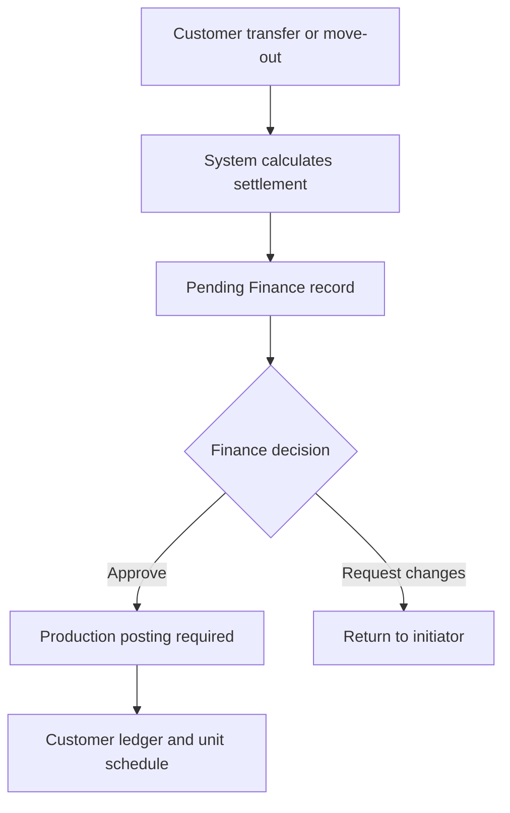
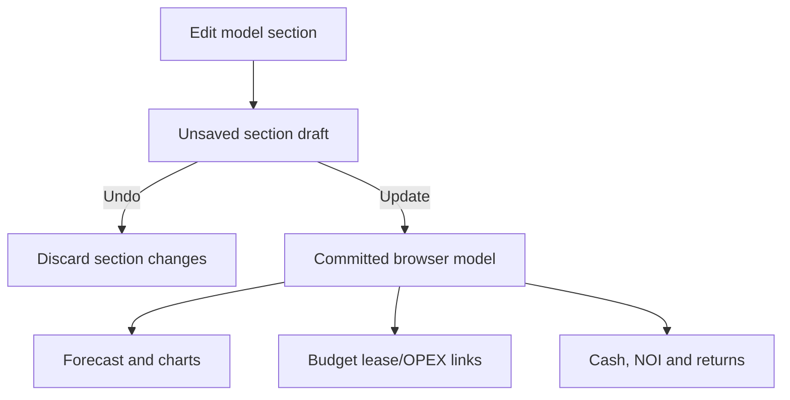

# StoreLah CRM prototype — delta handover

**Prototype:** <https://storelah-crm-leads.faisal-0213.chatgpt.site>  
**Handover date:** 4 November 2026 (Singapore)  
**Scope:** Leads, Customers and Finance only. This is a change-only handover; unchanged baseline behaviour is intentionally omitted.

## Comparison anchors

| Module | Baseline used | Current source | Reason |
|---|---|---|---|
| Finance | Commit `e5cebbe`, the last prototype source revision before 30 October 2026 | Commit `7932258` | Matches the supplied 30 October baseline: 12 Finance screens, seven-step journey and planning toolbar. |
| Leads | Commit `afa1971` | Commit `7932258` | The user supplied no dated Leads handover, so “the version before your latest changes” is interpreted as the revision immediately before the two latest Lead/Customer change sets. |
| Customers | Commit `afa1971` | Commit `7932258` | Same assumption as Leads. |

The prototype is a client-side demonstrator. Seed arrays and browser `localStorage` are identified below as **demo data**, not production persistence or an approved business system of record.

# 1. Summary

## Leads

- **NEW** Lead creation now writes the created record into the Lead database and pipeline instead of only closing the modal.
- **NEW** Date of enquiry, defaulted to the current Singapore date but editable, appears in Add lead, Add enquiry and the database table.
- **CHANGED** Product is standardised to **AC Self-Storage**.
- **CHANGED** Customer type is **Personal** or **Business**; Business captures company name, UEN and representative.
- **NEW** Clickable lead names open a full lead record with Overview, Enquiries and Notes & tasks.
- **NEW** Multiple enquiries can sit under one master identity; identity fields are locked when adding an enquiry from a lead.
- **NEW** Potential value and probability have explanatory tooltips and explicit calculations.
- **CHANGED** Access frequency is a controlled dropdown and includes **Not sure**.
- **CHANGED** Pipeline settings is a full stage/probability/ageing/entry/automation configuration dialog.
- **NEW** Appointments is calendar-first, filterable and colour-coded; a lead-originated appointment locks the lead and writes to the central calendar.
- **NEW** Quotations form a serialised register, require a lead/enquiry, support preview and print/PDF workflow, and restrict draft deletion to Administrators.
- **NEW** `@` mention typeahead creates an Overview notification for the selected user.
- **NEW** Global Settings contains a Lead & response SLA panel.
- **CHANGED** Minimum operational font size is 13 px; main copy is 15 px.

## Customers

- **NEW** Customer Overview adds agreement/move-in facts and services/add-ons.
- **NEW** Rental & pricing shows agreement date, move-in date, initial commitment, commitment end, time remaining, net rent, Protection Plan and monthly billing frequency.
- **NEW** Billing & payments adds a unit-level customer ledger for rent, Protection Plan, merchandise, moving services and payment allocations.
- **NEW** Staff can record moving, merchandise, Protection Plan or other service requests.
- **NEW** Transfer unit now selects a destination unit/date and displays a system-calculated settlement before submission to Finance.
- **NEW** Move-out and refund flows accept a staff-entered last access date when the portal has no request, reuse and lock a portal date when present, and calculate either a refund or a charge.
- **NEW** Special credits/charges require a category, amount and reason/evidence and can reverse a refund into a charge.
- **CHANGED** Protection Plan is explicitly non-proratable in transfers and closing settlements.
- **CHANGED** Unit/billing data remains unchanged until Finance approval.
- **NEW** Customer notes support `@` mention notifications.

## Finance

- **REMOVED** The seven-step **Financial planning & performance** journey bar.
- **REMOVED** Investor invitation/access UI; access is expected to be handled through ordinary Users & roles.
- **CHANGED** Finance typography and laptop layouts are larger and responsive; Reconciliation copy is no longer ultra-small.
- **CHANGED** Finance Overview adds operational KPIs, metric definitions/data lineage, real cash/accrual switching, more periods and working CSV export.
- **CHANGED** **Transactions & approvals** becomes **Transactions, documents & approvals**, a sortable, searchable register for invoices, payments, receipts, refunds, charges, credit notes, adjustments and transfer approvals.
- **REMOVED** Processor reference from the primary transaction table; it remains in record detail as evidence.
- **REMOVED** Duplicate header/action buttons and the unrelated “Review and decision” presentation.
- **CHANGED** Financial Models uses section-level Update/Undo, square-foot movement, editable capital, explicit landlord lease, 1/3/5-year cash positions, Year 1/2/3 NOI, NOI margin, interactive charts and date-aware opening-month proration.
- **CHANGED** Forecast vs actuals shows Budget/Forecast/Actual together and clearly labels the first three actual months as sample data.
- **CHANGED** Budgets & expenses makes landlord lease read-only and model-linked, stages category edits until Update, supports notes and has an individual expenditure ledger.
- **CHANGED** Size mix & pricing can sync unit inventory; **XS/S** display as **Xtra Small/Small**; **Monthly rent** is **Monthly rent potential**; pricing guardrails are an explicit expandable configuration.
- **CHANGED** Investment Returns is a single-column, non-overlapping layout with period selection and three understandable sensitivity cases.
- **CHANGED** Model Library is simplified and supports Save changes into the currently loaded draft, Save as new, Open, Duplicate, Submit and readable audit history.
- **CHANGED** Invoice functionality gained search, preview, customer/lead tagging and manual delivery, but **Invoices was removed from the Finance sidebar** and invoice access is now intended through the unified transaction/document register.
- **CHANGED** Arrears is an owned case workspace. Staff cannot manually resolve a case; an allocated payment, approved reversal or write-off resolves it.
- **CHANGED** Credits & refunds is renamed **Credits ledger (WIP)**. Refund initiation moved to Customer/Move-out; Finance approval moved to Transactions.

# 2. Changed module specifications

## Leads

### Cross-cutting readability

**Where it lives:** all Leads routes and dialogs. CSS: `dist/v29-request.css`; no render function.  
**Before → after:** mixed 9–12 px operational copy → `body` 15 px, operational labels/tables/buttons/inputs no smaller than 13 px, page headings 30 px, dialogs up to 1,240 px wide, responsive single-column layouts below 720 px.  
**Behaviour/data:** presentation only; no business data changes.  
**States:** responsive reflow is implemented; no loading or CSS error state.

### Lead database and Add lead

**Where it lives**

| Item | Value |
|---|---|
| Sidebar | Leads Management → Lead database |
| Hash / panel | `#leads`; database table `#leadRows` |
| Source | `dist/v29-request.js` |
| Render/action functions | `bootstrapLeadDirectory`, `renderLeadDatabase`, `renderPipeline`, `openLeadForm`, `setBusinessFields`, `saveLead` |

**Before → after**

- Add lead previously closed with a generic success message and did not populate the database → creates `SL-<sequence>`, prepends it to the live table and pipeline, stores it in `storelahLeadsV29`, and opens `#leads`.
- Database columns are now: selection; **Lead / customer type**; **Date of enquiry**; Status; Intent; **Product / facility**; Source; Owner; Next action; **Potential value**; Flags.
- Lead name is a button. Business rows show company name and `Representative: <name>`; Personal rows show name and mobile. Type pills are Business/blue and Personal/grey.
- Product is always **AC Self-Storage**.
- Status colours: New/blue; Qualified or Viewing/green; Quoted/terracotta; Lost or SLA breach/red; all other states/grey.
- New Add lead layout is a three-column wide dialog: identity, enquiry, requirement, value and assignment fields. Business-only fields expand in place.

**New/changed fields and data contract**

| Field | Type / format | Example | Source / write |
|---|---|---|---|
| `id` | string, `SL-####` | `SL-2842` | Calculated from highest current numeric lead ID; written to lead array and `storelahLeadsV29`. |
| `customerType` | enum | `Personal`, `Business` | User input. |
| `name` | string | `Sarah Tan` or `Northstar Commerce Pte Ltd` | Personal full name or Business company name. |
| `representative` | string, required for Business | `Jason Lee` | User input; absent for Personal. |
| `uen` | string, required for Business | `202498877N` | User input. |
| `email`, `phone` | strings; at least one required | `sarah@email.com`, `+65 9123 4821` | User input. |
| `dateEnquiry` | `YYYY-MM-DD` input; displayed `D Mon YYYY` | `2026-11-04` → `4 Nov 2026` | Defaults to current Asia/Singapore date; editable. |
| `source` | enum | Website, WhatsApp, Phone, Walk-in, Google Ads, Referral, Partner | User input; source code is derived for compact table display. |
| `product` | constant string | `AC Self-Storage` | Read-only. |
| `facility` | enum | StoreLah Sembawang, No preference | User input. |
| `size` | enum | Not sure; Up to 25 sq ft; 26–50; 51–100; 100+ | User input. |
| `moveIn` | date | `2026-11-10` | User input. |
| `durationMonths` | integer months | `3`, `6`, `12` | User input; Not sure/Ongoing uses planning default 6. |
| `access` | enum | Not sure, Daily, 2–3 times weekly, Weekly, 2–3 times monthly, Monthly, Rarely/archive | User input. |
| `monthlyNet` | number, SGD/month | `320` | User input; estimate only. |
| `value` | formatted SGD | `$1,920.00` | Calculated potential value. |
| `owner` | user name | `Nur Aisyah` | Auto-assign currently resolves to Nur Aisyah; otherwise selected user. |
| `status`, `intent`, `next`, `flag` | status strings / integer 1–5 | New, `2`, First response due, New enquiry | Prototype defaults. |
| `notes` | free text | storage constraints | User input. |

**Behaviour and validation**

- Required: customer type, date of enquiry, Personal full name or Business company/UEN/representative, and at least one of email/mobile.
- **Check for existing lead** currently shows a no-match toast; the intended normalised email/mobile/UEN merge is copy only and is not implemented.
- Successful save refreshes database and pipeline and shows: **“SL-#### created and captured in the Lead database.”**
- Validation toast: **“Complete the required identity fields and provide an email or mobile number.”**
- Identity-check toast: **“Identity check complete. No exact email, mobile or UEN match found.”**
- No role restriction is enforced for creation.

**States**

- Empty/search: **“No leads match this search.”**
- Loading: none; data is synchronous in memory/localStorage.
- Error: inline form state is not implemented; validation uses the toast above. Malformed localStorage falls back to an empty array.

**Exact primary copy**

- Heading: **“Add a new lead”**
- Kicker: **“MASTER IDENTITY + FIRST ENQUIRY”**
- Help: **“One identity, many enquiries”** and **“Email, mobile and UEN are checked before save. A matching person or company receives another enquiry instead of a duplicate lead.”**
- Footer: **“Date of enquiry defaults to today and may be changed.”**
- Primary action: **“Create lead & enquiry”**

### Lead record, enquiries, requirement and notes

**Where it lives**

| Item | Value |
|---|---|
| Entry | Click a name in Lead database, Pipeline or Quotation register |
| Hash | Newly created leads: `#lead-profile-v29`; seeded records: `#lead-profile-v2` |
| Tabs | Overview; Enquiries; Notes & tasks |
| Source | `dist/v29-request.js`, with base seeded profile in `dist/crm-ux-v2.js` |
| Functions | `openSavedLead`, `augmentLeadProfile`, `openExistingEnquiryForm`, `saveExtraEnquiry`, `openLeadRequirement`, `saveLeadRequirement`, `installMentionMenu`, `captureMentions`, `openNotifications` |

**Before → after**

- Name click no longer opens a shallow drawer → opens a dedicated lead page.
- Hero includes identity/contact, type, representative/UEN where applicable, product, actions and KPIs.
- KPI row adds Total enquiries, Potential value, Probability, Date of enquiry and Assigned salesperson.
- Enquiries tab retains multiple dated requirements under the same lead.
- Add enquiry from a lead locks name, email and mobile; Business also locks company name, UEN and representative. It does not allow identity substitution.
- Requirement Access frequency is a dropdown with **Not sure** plus six defined frequencies.
- Notes support `@` typeahead from: Faisal, Nur Aisyah, Marcus Lim, Ravi Kumar, Finance Admin, Facility Team, Sales Manager.

**Enquiry fields written to `storelahExtraEnquiriesV29`**

`id:string ENQ-######`; `leadId:string`; `date:D Mon YYYY`; `source:enum`; `product:constant AC Self-Storage`; `facility:enum`; `size:enum`; `access:enum`; `duration:enum/string`; `move:date`; `notes:string`; `status:New`; `quote:Not created`.

**Behaviour and validation**

- Add enquiry requires an existing lead context; otherwise toast: **“Open a lead first.”**
- Save prepends the enquiry, refreshes history and updates the lead's displayed enquiry date.
- Success: **“ENQ-###### saved under <lead name>.”**
- Requirement Update changes the active opportunity and quote inputs; older enquiries remain conceptually immutable. Current prototype changes only displayed active values, not a durable requirement object.
- Requirement success: **“Lead requirement updated across the active opportunity and quote inputs.”**
- `@User` selection inserts the full username. Saving creates `storelahMentionNotificationsV29` entries and updates the top notification badge.
- Mention success: **“Mention notification sent to <names>.”** A generic lead note then shows **“Note saved.”**
- Notification drawer empty state: **“No mention activity yet”** / **“Type @ in a lead note, customer note or task instructions.”**
- No loading state. Missing context uses a toast; there is no server error state.

**Exact tooltip copy**

- Potential value: **“Potential value = expected net monthly rent × expected billed months. When duration is ‘Not sure’ or ongoing, the planning default is 6 months until staff confirms it. It is an opportunity estimate, not recognised revenue.”**
- Probability: **“Stage probability starts at [x]% for ‘[status]’. The production score then applies capped signals: complete qualification +10, confirmed viewing +5, quote viewed +5, booking started +15, first-response SLA breach −5 and no activity for 7+ days −10. The result is capped between 0% and 100% and remains explainable in the audit trail.”**

### Pipeline and Pipeline settings

**Where it lives:** Leads Management → Pipeline, `#pipeline`; settings modal launched from Pipeline settings. Source `dist/v29-request.js`; `renderPipeline`, `openPipelineSettings`.  
**Before → after:** basic stage form → stage table with Probability, Maximum ageing, Required before entry and Automation, plus assignment rule, lost reasons, required next action and Global Settings SLA jump. Pipeline cards now show AC Self-Storage, facility, value, stage probability, owner and enquiry date.

**Stage defaults and colours**

| Stage | Probability | Maximum ageing | Colour |
|---|---:|---:|---|
| New | 10% | 15 min | `#547b8d` |
| Contacted | 20% | 60 min | `#6c8490` |
| Qualified | 40% | 120 min | `#5d6e52` |
| Viewing set | 55% | 24 h | `#c98a58` |
| Quoted | 65% | 24 h | `#a96245` |
| Booking started | 80% | 12 h | `#8b6743` |
| Paid booking | 95% | 4 h | `#55775f` |
| Converted | 100% | no limit | `#3e6648` |
| Lost | 0% | no limit | `#9b5a54` |

Additional displayed status mapping: **Nurturing 15%** and **Converted to customer 100%**.

**Behaviour/states:** settings save currently shows **“Pipeline settings saved as a new version.”** but does not write the edited table back to `storelahPipelineV29`; this is a prototype placeholder. Empty pipeline columns remain visible with Add lead. No loading/error state.

### Appointments

**Where it lives:** Leads Management → Appointments, `#calendar`; source `dist/v29-request.js`; `appointments`, `filteredAppointments`, `renderAppointments`, `openAppointmentForm`, `saveAppointment`, `appointmentDetailV29`, `setCalendarPeriod`.  
**Before → after:** basic schedule list → calendar-first page with Calendar/Agenda views, period/type/staff/status filters, a filtered agenda and colour legend.

**Filters and colours**

- Period: Week of 2 Nov 2026; Today; Next 7 days; This month; Custom range.
- Type: Facility viewing `#c97952`; Call `#547b8d`; Video consultation `#8060a2`; Move-in handover `#5d6e52`.
- Staff: Nur Aisyah, Marcus Lim, Ravi Kumar.
- Status: Proposed, Confirmed, Awaiting reply, Ready, Completed.

**Appointment data:** `id:string AP-######`; `leadId`; `leadName`; `enquiry`; `type:enum`; `date:YYYY-MM-DD`; `time:HH:mm`; `duration:30/45/60 minutes`; `staff`; `facility/method`; `status`; `notes`. New rows are written to `storelahAppointmentsV29`; seed rows remain demo data.

**Behaviour and validation**

- From a lead profile, Lead is prefilled/read-only. From the central calendar, a lead must be selected.
- Save writes to lead context and central calendar, navigates to `#calendar`, and shows **“AP-###### saved to the lead and Appointments calendar.”**
- Missing lead: **“Select a lead.”**
- Custom range requires both dates and `end >= start`; exact errors: **“Choose both the start and end date.”** and **“The end date must be on or after the start date.”**
- Empty: **“No appointments match”** / **“Change the date range or clear one of the filters.”**
- Loading/server error: none.
- Calendar sync is a placeholder toast: **“Calendar integration settings opened.”**

### Quotations

**Where it lives:** Leads Management → Quotes, `#sales`, side panel/tab `sales-quotes`; source `dist/v29-request.js`; `renderQuotes`, `openQuoteBuilder`, `selectQuoteLead`, `quoteDraft`, `previewQuote`, `saveQuote`, `quoteMore`, `deleteQuote`, `nextQuoteNumber`.  
**Before → after:** shallow quote action and irrelevant Configure targets → a serialised quotation register. Configure targets is removed.

**Layout**

- Summary: Total quotations, Awaiting follow-up, Accepted, Drafts.
- Search: quotation number, lead, enquiry, unit or owner.
- Filters: status and facility.
- Table: Quotation; Lead/enquiry; Storage option; Gross/net monthly; Created/expiry; Delivery; Status; Owner; Clear actions.
- Status colours: Accepted/green; Draft/grey; Expired or Voided/red; Sent/Viewed/blue.

**Quote fields:** `number:QT-YYYY-#####`; `leadId`; `leadName`; `enquiry`; `unit`; `gross:number SGD`; `promotion:number %`; `net:number SGD`; `protection:number SGD`; `commitment:3/6/12 months`; `expiry:date`; `created`; `status`; `delivery`; `owner`. Saved rows use `storelahQuotesV29`; sequence uses `storelahQuoteSequenceV29`.

**Behaviour/permissions**

- Lead and enquiry are mandatory. Search matches ID, name/company, email, mobile or UEN.
- A lead-originated builder locks the lead.
- Preview does not consume a number. Save assigns the next number, status Sent and delivery **“Email + WhatsApp · queued.”**
- Preview buttons: Close; Export PDF (implemented as browser print for saved quotes); Send/resend.
- More actions: Preview customer copy; Duplicate as draft; Void quote; Delete draft · Admin only.
- Only `currentRole === Administrator` may delete, and only a Draft. Sent/issued/accepted quotes must be voided to retain history.
- Exact errors: **“Search and select a lead before previewing.”**, **“Select a lead.”**, **“Only Administrators may delete draft quotes.”**, **“Issued, sent or accepted quotations cannot be deleted. Void them to retain the audit trail.”**
- Exact success: **“QT-2026-##### serialised, sent and added to the quotation register.”**, **“QT-… delivery queued by email / WhatsApp and logged.”**, **“QT-… marked void; the serialised record remains in history.”**, **“QT-… draft deleted by Administrator.”**
- Empty: **“No quotations match.”** Loading/server error: none.

### Lead response SLA

**Where it lives:** Global Settings → Lead & response SLA, `#settings`, panel `settings-lead-sla`; shortcut button **Lead response SLA**. Source `dist/v29-request.js`; `installSlaSettings`, `installSlaShortcut`, `openSlaSettings`.  
**Before → after:** SLA was implied → dedicated channel targets, clock rules and escalation.

| Channel | Default | Options |
|---|---:|---|
| Website | 15 min | 15 min, 30 min, 1 h |
| WhatsApp | 15 min | 15 min, 30 min, 1 h |
| Phone / missed call | 10 min | 10 min, 15 min, 30 min |
| Email | 30 min | 30 min, 1 h, 4 h |

Clock defaults: business hours only on; pause on Singapore public holidays on; WhatsApp 24/7 off. Warning default is 80% of target; escalation default is Sales Manager + assigned salesperson. Exact definition: **“The clock starts when a new enquiry is created and stops at the first meaningful human response. Automated acknowledgements do not stop it.”** Save writes only `{savedAt: ISO timestamp}` to `storelahSlaV29` and shows **“First-response SLA settings saved and audited.”** Detailed selected values are not yet persisted.

### Leads calculations

1. **Potential value**  
   `potential_value = expected_net_monthly_rent × expected_billed_months`  
   Worked example using Add lead defaults: `$320 × 6 months = $1,920`.

2. **Displayed stage probability**  
   `displayed_probability = stageProbability(status)` in the current prototype.  
   Intended production rule shown in the tooltip:  
   `score = clamp(stage_base + qualification(10) + viewing(5) + quote_viewed(5) + booking_started(15) − SLA_breach(5) − inactivity_7d(10), 0, 100)`  
   Worked example: Qualified starts at 40%; complete qualification +10 and confirmed viewing +5 would produce 55%. The prototype currently displays the 40% stage base rather than evaluating the signals.

3. **Quote net rent and monthly payment**  
   `net_rent = gross_rent × (1 − promotion_percent / 100)`  
   `estimated_monthly_payment = net_rent + protection_plan`  
   Worked example: `$468 × (1 − 10%) = $421.20`; `$421.20 + $12.50 = $433.70`.

## Customers

### Customer profile additions

**Where it lives:** Customer Management → Customer list → click customer name, `#customer-profile`; tabs Overview, Rental & pricing, Billing & payments, Documents, Access, Move-out & transfers, Notes & activity. Source `dist/v29-request.js` augmentation over `dist/crm-ux-v2.js`; `augmentCustomerProfile`, `openCustomerV2`, `customerProfileHtml`, `customerPanelsHtml`.  
**Before → after:** existing Customer 360 remains; latest change adds lifecycle facts, services and a ledger without introducing another directory.

**Overview additions**

- **Agreement and move-in:** Agreement signed, Move-in date, Committed duration, Commitment ends, Time remaining, Protection Plan.
- **Services and add-ons:** Moving service, Merchandise, Protection Plan, Ledger treatment, **+ Add request**.

**Rental & pricing additions**

- Card **Rental commitment and recurring charges**.
- Status pill: **Within commitment**/amber or **Commitment completed**/green.
- Exact help: **“Commitment controls early-exit treatment; rent is still billed monthly.”**
- Fields: Agreement signed, Move-in, Initial commitment, Commitment end, Remaining, Net monthly rent, Protection Plan monthly, Billing frequency = Monthly.

**Billing & payments additions**

- **Customer ledger** columns: Date; Document; Unit; Line item; Status; Debit; Credit/payment.
- Line types: monthly AC self-storage rent, Protection Plan, merchandise, moving service, payment allocation.
- Status colours: Pending approval/amber; Paid or Allocated/green.
- Exact routing copy: **“Start a refund from this customer context or a move-out preview. Review, approve and process it in Finance → Transactions, documents & approvals. There is no competing standalone refund module.”**

**Add service request modal**

- Fields: Request type = Moving service / Merchandise / Protection Plan change / Other service; Preferred date; Details.
- Success: **“Service request saved to the customer timeline and ledger workflow.”**
- This is a toast-only prototype; it does not persist a service record.

**Customer lifecycle data read by the additions**

| Field | Type / format | Examples | Source status |
|---|---|---|---|
| `sign`, `move`, `commitEnd` | display dates | `12 Sep 2026`, `14 Sep 2026`, `13 Mar 2027` | **Demo** `customerMeta`. Production: agreement/move-in services. |
| `duration`, `remaining` | display strings | `6 months`, `4 months 9 days` | **Demo**; production should calculate from commitment dates. |
| `protection` | SGD/month string | `$12.50 / month` | **Demo**; production: unit recurring charge. |
| `moving` | service status string | `Completed · Seung Services · 14 Sep 2026 · $120` | **Demo**; production: service order. |
| `unit` | unit ID | `SB-01-041` | **Demo**; production: active unit schedule. |
| `rent` | number SGD/month | `320` | **Demo**; production: current net unit rate. |
| `deposit` | number SGD | `0` | **Demo**; production: customer/unit deposit ledger. |
| `portalMoveOut` | blank or `YYYY-MM-DD` | `2026-11-15` | **Demo**; production: customer portal notice. |

**States:** additions render only when a known `customerMeta` name matches. There is no loading state. Unknown customer metadata silently omits the added cards; this is the current error/fallback state.

### Transfer unit

**Where it lives:** Customer profile → More actions → Transfer unit, or Move-out & transfers → Transfer unit; `#customer-profile`. Source `dist/v29-request.js`; `openTransfer`, `calculateTransfer`, `submitTransferV29`, `specialAdjustmentFields`, `validSpecialAdjustment`, `outcomeCard`.  
**Before → after:** generic “transfer draft created” → destination selector, transfer date, pricing/deposit inputs, line-by-line settlement, next full deduction and Finance submission.

**Fields**

- Read: current unit, current net monthly rent, current security deposit.
- Input: transfer date; destination facility; new unit; destination Protection Plan; destination security deposit; transfer reason; optional adjustment type/category/amount/reason.
- Destination option payload format: `unit|sqft|grossRent|promoPercent`.
- Write: pending `Transfer approval` in `storelahTransferApprovalsV2` with `id`, date, customer, customerId, old→new unit, facility, unitType, document, category, method, signed amount, status, approver and processor placeholder.

**Behaviour/permissions**

- Recalculates on date, unit, Protection Plan, deposit and adjustment changes.
- Destination price/promotion takes precedence.
- Protection Plan is not prorated; it starts on the next billing cycle.
- Optional adjustment reason is mandatory when type is selected and amount > 0. Error: **“Add a reason for the special refund or charge.”**
- Submit creates `TRF-#######`, status **Pending approval**, approver **Finance review**. Unit and billing schedule do not change.
- Success: **“TRF-####### submitted to Finance. The unit and billing schedule remain unchanged until approval.”**
- Prototype exposes submit to any viewer; production must enforce authorised customer-service/operations initiation plus Finance approval.
- No loading state; missing date prevents calculation without a dedicated message in Transfer.

**Exact copy**

- Heading: **“Transfer unit · <customer>”**
- Kicker: **“SYSTEM-CALCULATED TRANSFER SETTLEMENT”**
- Help: **“The transfer date drives the proration”** and **“The system credits the unused current-unit rent and charges destination-unit rent for the same remaining days. Destination pricing and promotions take precedence. Protection Plan is never prorated.”**
- Footer: **“Nothing posts until Finance approves the transfer settlement.”**

### Move-out and refund/closing charge

**Where it lives:** Customer profile → Move-out & transfers / More actions; Billing & payments → Start refund request. Hash `#customer-profile`. Source `dist/v29-request.js`; `openMoveout`, `calculateMoveout`, `submitMoveout`, `openRefund`, `calculateRefund`, `submitRefund`, `closingSettlement`.  
**Before → after:** date could not be selected and refund logic was disconnected → portal-aware/staff-assisted date capture, system-calculated closing balance, special credit/charge and Finance queue write.

**Move-out fields:** unit; request received date; customer's last access day; request channel; reason; commitment status; net monthly rent; security deposit held; Protection Plan; customer/staff note; optional adjustment.  
**Refund fields:** customer; unit; move-out date; net monthly rent; security deposit held; Protection Plan; optional adjustment.

**Portal behaviour**

- If `portalMoveOut` exists: date is prefilled/read-only, channel is Customer portal and disabled.
- If absent: staff must enter the date received by WhatsApp, phone, email or onsite.
- Missing date shows: **“Move-out date required”** / **“Enter the customer’s last day of access. The system will then calculate unused rent and the closing balance.”**

**Outcome and write**

- Non-negative result creates `RF-#######`, docType Refund, method Original payment method.
- Negative result creates `CH-#######`, docType Charge, method Customer payment method.
- Amount is stored with transaction-sign convention: refund rows are negative transaction amounts; charge rows are positive.
- Status **Pending approval**; no processor instruction until approval.
- Move-out success: **“Move-out recorded for <date>. RF-/CH-… is awaiting Finance approval.”**
- Refund success: **“RF-/CH-… created in Finance → Transactions & approvals.”**

**Special adjustment categories:** Service recovery; Duplicate payment correction; Early termination fee; Damage to unit/door; Cleaning fee; Lock replacement; Merchandise or moving service; Other. Reason/evidence is mandatory when an adjustment has a non-zero amount.

**States:** outcome card green for Refund to customer and red for Charge customer. No loading/server error state. Finance may approve/reject/return; current prototype approval only changes transaction status and does not execute payment or ledger posting.

### Customer calculations

1. **Transfer**  
   `remaining_days = days_in_month − transfer_day + 1`  
   `source_credit = current_net_rent × remaining_days / days_in_month`  
   `destination_net_rent = destination_gross_rent × (1 − destination_promo_percent / 100)`  
   `destination_charge = destination_net_rent × remaining_days / days_in_month`  
   `deposit_delta = destination_deposit − current_deposit`  
   `transfer_amount_due = destination_charge − source_credit + deposit_delta + special_charge − special_credit`  
   Worked example for Sarah on 20 Nov: remaining `11/30`; current credit `$320 × 11/30 = $117.33`; destination net `$468 × 90% = $421.20`; destination charge `$421.20 × 11/30 = $154.44`; deposits and adjustments `$0`; customer pays **$37.11**. Next full deduction is `$421.20 + $12.50 = $433.70`.

2. **Move-out/refund**  
   `unused_days = days_in_month − last_access_day`  
   `unused_rent_credit = net_monthly_rent × unused_days / days_in_month`  
   `closing_refund = unused_rent_credit + security_deposit + special_credit − special_charge`  
   `protection_plan_refund = 0`  
   Worked example: last access 20 Nov, rent `$320`, deposit `$0`: `$320 × 10/30 = $106.67` refund. Add `$150` damage charge: `$106.67 − $150 = −$43.33`; the outcome becomes a **$43.33 charge**.

## Finance

### Cross-cutting navigation, typography and planning shell

**Where it lives:** Finance Management, `#billing`; sidebar built in `dist/experience.js` `sideNav.billing`; global Finance presentation in `dist/crm-refresh.css`, `dist/crm-ux-v2.css`; shared toolbar in `dist/financial-model.js` `toolbar`, `updateHeader`, `financeJourney`.  
**Before → after:** seven-step journey with **Financial planning & performance**, **Investor-ready** and Investor access → `financeJourney()` returns an empty string. The ordinary Finance sidebar remains the primary navigation. The planning toolbar retains Facility, Loaded model, Operational start and Downside/Base/Upside. Header-wide Billing settings, Reconciliation and Create invoice buttons no longer repeat on every page.

**Readability delta:** 30 px page headings; 14–15 px body; 13–14 px controls; finance table cells approximately 13 px; responsive KPIs become 3 columns under 1,450 px and 2 columns under 1,100 px; model sections/charts stack on laptops. Operational copy is later overridden to the 13 px minimum by `v29-request.css`.

### Finance Overview

**Where it lives:** Finance Management → Finance overview, `#billing`, panel/tab `bill-overview`. Source `dist/financial-model.js`; `financeOverviewData`, `financePeriodOptions`, `renderFinanceOverviewV2`, `exportFinanceSummary`.  
**Before → after:** three coarse periods and static accounting basis → Today, Last 7 days, Last calendar week, Month to date, Last month, Quarter to date, Year to date, Custom; cash/accrual changes the revenue KPI and explanation; every KPI has a data-lineage tooltip; operational sign-ups/units/moves are added; Export summary downloads CSV.

**Layout order**

1. Filters: Reporting period; Facility; Accounting basis; basis explanation; Export summary; Open payment operations.
2. Finance KPIs: Revenue billed/Cash-basis revenue; Cash collected; Accounts receivable; Overdue balance; Failed payments; Credits & refunds.
3. Operational KPIs: New sign-ups; Occupied units; Move-ins; Move-outs.
4. Collection performance and Cash/control snapshot.
5. Priority finance actions and Finance health checks.

**Data fields**

| Field | Type | Example MTD | Intended production source | Current prototype source |
|---|---:|---:|---|---|
| billed | SGD number | 285,400 | Invoice ledger less credit notes | `financeOverviewData` seed object |
| collected | SGD number | 280,000 | Allocated card/PayNow/bank receipts | Seed object |
| outstanding | SGD number | 11,800 | Open invoices less payments/credits | Seed object |
| overdue | SGD number | 3,400 | Invoice ageing | Seed object |
| failed / failedValue | count / SGD | 8 / 2,840 | Processor results | Seed object |
| refunds / credits | SGD | 1,280 / 6,400 | Approval queue / wallet ledger | Seed object; credits product is WIP |
| signups | count | 82 | Activated customer agreements | Seed object |
| occupiedUnits | count | 68 | Facilities unit status | Seed object |
| moveIns / moveOuts | counts | 71 / 19 | Agreement activation/termination | Seed object |
| moveInSqft / moveOutSqft | sq ft | 1,786 / 482 | Facilities/customer unit events | Seed object |

**Behaviour/states**

- Accrual revenue = billed; Cash revenue = collected. MTD changes from `$285,400` to `$280,000` when basis changes.
- Export file name: `StoreLah_Finance_Summary_<period>_<basis>.csv`; success **“Finance summary CSV downloaded”**.
- Failed payments and Open payment operations route to `bill-transactions`.
- Custom period opens a date dialog, but the selected dates are not stored; current custom data remains the seeded 1–29 Oct range.
- Facility filter is visual only.
- No loading/empty/error state because data is embedded. Export uses browser Blob download and has no failure state.

### Transactions, documents & approvals

**Where it lives:** Finance Management → Transactions, documents & approvals, `#billing`, panel `bill-transactions`. Source `dist/crm-ux-v2.js`; `renderTransactionsV2`, `bindTxTable`, `openTransaction`, `updateTx`, `financialDocument`, `routeToTransactions`, `transferRows`.  
**Before → after:** payment-only register with repeated controls, invoice column and processor reference → one compact record register. Processor evidence moves to detail. Invoice is now one document type rather than a universal column.

**Filters/actions:** free search across ID/document/customer/unit/facility/payment method; period; facility; unit type; document type; status; Export; New document. Sort by clicking Date, Record ID, Customer, Document, Purpose, Payment method, Amount, Status or Approval/owner.

**Document types:** Invoice; Refund; Charge; Credit note; Transfer approval; Adjustment.  
**Statuses/colours:** Paid, Posted, Resolved, Approved = green; Failed, Rejected = red; Pending, Awaiting = amber; other = blue.

**Primary columns:** Date; Record ID; Customer/unit; Document; Purpose; Payment method; Amount; Status; Approval/owner; Action. The detail drawer/modal contains Customer, Unit, Document, Purpose, Amount, Method, Status, Approval/owner, Processor reference, Scheduled/posted.

**Transaction data contract**

`id:string`; `date:D Mon YYYY`; `customer:string`; `customerId:string`; `unit:string`; `facility:string`; `unitType:enum`; `document:string`; `docType:enum`; `category:string`; `method:string`; `amount:number SGD` (negative refund/credit, positive charge/payment); `status:enum`; `approver:string`; `processor:string`.

Sources are: embedded `baseTransactions` (**demo**); plus `storelahTransferApprovalsV2` (**prototype writes** from Customer transfers/refunds/move-outs). Production sources should be invoice ledger, payment provider, reconciliation, customer/unit schedules and approval service.

**Behaviour/permissions**

- Pending records show **Review**; other records show **Open**.
- Pending detail explains **“No provider instruction created yet”** and offers Request changes / Approve.
- Approve currently changes status to Approved and stamps `Finance Admin · <date>`; Request changes uses Rejected. It does not call Stripe/bank APIs.
- Intended role is Administrator/Finance approver; current prototype does not authenticate the role.
- New document can choose Invoice, Refund, Charge, Credit note or Adjustment and creates a draft conceptually; current Save draft action is a preview/toast placeholder.
- Empty: **“No records match these filters.”**
- Loading/error: none. Invalid localStorage falls back to base transactions.
- Custom period is listed but has no custom-date dialog in this final register.

**Exact primary copy**

- Heading: **“Transactions, documents & approvals”**
- Subheading: **“Review every payment-related document and approval from one searchable register.”**
- Explainer: **“One register for payment-related records”** and **“Invoices, payment instructions, receipts, refunds, credit notes, adjustments and unit-transfer approvals are searchable here. A processor reference is kept inside transaction detail because it is evidence—not a useful primary table column.”**

### Financial Models

**Where it lives:** Finance Management → Financial models, `#billing`, panel `bill-model`. Source `dist/financial-model.js`; `renderModelControlled`, `calculate`, `forecastTable`, `commitModelSection`, `bindControlledModel`, `chartDefinitions`, `chartCardV2`, `bindChartHover`, `annualRows`, `applyScenario`.  
**Before → after:** direct edits and confusing mixed assumptions → committed model plus staged section edits. Each of Occupancy plan, Capital investment, Customer pricing and Landlord lease has independent Undo/Update. Pending changes do not affect the main model until Update.

**Layout order**

1. Planning toolbar.
2. **Committed financial model** instruction and partial opening-month notice when applicable.
3. KPIs: Year 1 occupied area; Year 1 net move-in; 1/3/5-year cash position; Year 1/2/3 NOI with margin.
4. Month-by-month performance table (12/24/60), Yearly summary, CSV.
5. Interactive charts: Occupied area ramp; Monthly space movement; Revenue versus operating costs.
6. Editable sections 1–4.
7. Operating milestones (moved above Calculation checks by the layout reconciler and both collapsed on applicable renders).
8. Calculation checks.

**Changed fields**

| Section | Field | Type / format | Example |
|---|---|---|---|
| Toolbar | Operational start | date, may be mid-month | `2026-12-01` |
| Occupancy | Gross move-ins months 1–6 / month 7+ | sq ft/month | 180 / 125 |
| Occupancy | Monthly move-out rate | percent of opening occupied NLA or sq ft at stabilisation | 2.5% |
| Occupancy | Move-outs begin | model month integer | 7 |
| Occupancy | Stabilisation occupancy | percent of NLA | 92% |
| Capital | capital item name/amount | string / SGD | Smart locks / 15,000 |
| Customer pricing | Annual customer rent increase | percent | 3% |
| Customer pricing | projection period | 1, 3, 5, 7 years | 3 years |
| Landlord lease | UFA | sq ft | 3,068 |
| Landlord lease | rent-free period | integer months | 0 |
| Landlord lease | monthly rent by lease year | SGD/month, 7 entries supported | 5,000 |

**Monthly performance columns:** Month; Opening occupied; Move-in; Move-out; Net move-in; Closing occupied; Occupancy; PSF; Rental revenue; Operating costs; NOI; NOI margin; Cash position. Values are centred by current CSS. **PSF** replaces “per occupied sq ft”.

**Chart behaviour:** 12/24/60-month selectors; Zoom opens an expanded modal; pointer hover displays the nearest month and every series value at the cursor with a vertical crosshair. Budget/forecast lines are dotted where specified; actuals are solid. Empty actual points are omitted rather than plotted as zero.

**Update/Undo**

- Input marks only its section **Unsaved changes** and enables Undo/Update.
- Update commits the section, persists `storelahFinanceModelStateV2`, recalculates forecast, charts, cash, NOI and returns.
- Lease toast: **“Landlord lease updated. Monthly lease, budgets, forecast, cash flow and Investment Returns are synced.”**
- Other section toast: **“<Section> updated. Main forecast and Investment Returns are synced.”**
- Undo: **“<Section> changes undone.”**
- No role restriction is enforced. No server loading/error state; invalid date gives **“Choose a valid operational start date.”**

**Scenario behaviour:** Base is the last saved occupancy plan. Downside changes only move-ins −20%, churn +25%, stabilisation −5%; Upside changes only move-ins +20%, churn −20%, stabilisation +3%. Pricing, start date, lease, OPEX and capital remain unchanged.

### Forecast vs actuals

**Where it lives:** Finance Management → Forecast vs actuals, `#billing`, panel `bill-actuals`. Source `dist/financial-model.js`; `demoActualRows`, `renderActualsDemo`, `loadModelDraft`, `loadApprovedModel`.  
**Before → after:** missing Forecast values and future Actual values that looked real → Budget, Forecast and Actual remain together; forecast always comes from the loaded model; Actual is `—` unless sample mode or closed-period imports exist.

**Table columns:** Month; Budget/Forecast/Actual revenue; Budget/Forecast/Actual occupancy; Budget/Forecast/Actual costs; Budget/Forecast/Actual NOI; Status.

**Data rules**

- Budget = approved `defaultApprovedModelState` snapshot.
- Forecast = current loaded model/draft and scenario.
- Actual = closed data. Prototype sample mode generates only first three months using fixed factors: revenue 94%, 103%, 98%; cost 102%, 97%, 104%; occupancy −0.6pp, +0.8pp, −0.4pp; move-in 91%, 106%, 96%; move-out 108%, 95%, 104%.
- Sample rows are explicitly status **Sample actual**/green; remaining rows **Forecast**/amber.
- Loading a draft recalculates Forecast but never rewrites Budget or Actual.

**Actions/states**

- Reporting window: 12, 24 or 60 months.
- Show/Hide sample actuals; exact toasts **“Sample actuals shown”** / **“Sample actuals hidden.”**
- Import accounting actuals opens a `.csv,.xlsx` picker and then only shows “<file> queued for mapping and validation”; mapping is not implemented.
- Prepare month close is a modal placeholder.
- Empty actual = em dash. No loading/server error UI.
- Exact help: **“Budget is the approved target, Forecast is the latest outlook, and Actual is posted only after close.”**

### Budgets & expenses

**Where it lives:** Finance Management → Budgets & expenses, `#billing`, panel `bill-budgets`. Source `dist/financial-model.js`; `renderBudgetsControlled`, `budgetLinesForMonth`, `ensureBudgetDraft`, `expenseTotals`, `controlledBudgetRow`.  
**Before → after:** category-only figures and lease ambiguity → monthly selector, staged budget edits with Update/Undo, explicit model-linked read-only lease, line notes and individual expenditure ledger.

**Budget fields:** month; view; update scope = selected month only or this month onward; per-category Budget, Actual, Committed, Forecast, Variance, Note. Lease is read-only.  
**Expenditure fields:** Date; Reference; Vendor; Description; Category; Amount; Status; Note. Status colours: Paid/green; Committed/amber; Draft/grey.

**Behaviour**

- Editing budget/note creates a month draft and enables Undo/Update.
- Update future: normalises partial-month values into recurring OPEX, preserves prior overrides and carries the budget forward.
- Update month-only: writes one `opexOverrides[YYYY-MM]` entry.
- Success: **“<Month> operating budget saved [and carried into future forecast months / for this month only]. Forecast, NOI, cash flow and Investment Returns are recalculated.”**
- Undo: **“<Month> budget changes undone.”**
- Empty ledger: **“No expenditure entered for this month.”**
- Add category/expenditure and Edit are modal workflows; persistence is browser-only.
- No loading/server error state.

### Size mix & pricing

**Where it lives:** Finance Management → Size mix & pricing, `#billing`, panel `bill-size-mix`. Source `dist/financial-model.js` `renderMix`, `mixRow`, `weightedRate`; guardrail modal in `dist/crm-ux-v2.js` `pricingGuardrails`; collapsible treatment in `tidyFinance`.  
**Before → after:** manual NLA only and abbreviated sizes → Facilities inventory sync/manual override, Xtra Small/Small labels, editable NLA/units/net PSF, **Monthly rent potential**, enlarged totals, collapsible Rent potential and Pricing guardrails.

**Fields:** Category; Range; NLA sq ft; Units; Net $/sq ft; Monthly rent potential. KPIs: Facility NLA; Allocated size-mix NLA; Weighted net PSF; Monthly rent potential; Year 5 monthly rent; Year 5 annualised rent.

**Inventory sync:** reads `state.inventory.items` (demo Facilities dataset), replaces only NLA and unit counts, keeps rates, marks Synced, persists and recalculates. Exact success: **“Size mix synced and saved from Facilities unit inventory.”** **View unit inventory** routes to Facilities → Unit map/floor plans.

**Pricing guardrails modal fields:** minimum net PSF for Xtra Small, Small, Medium and Large; approval threshold; approval role; review cadence; demand signal; automated checks for Minimum PSF, Discount depth, Occupancy pressure and Promotion stacking. Save is a prototype toast; settings are not persisted.

**States:** source pill green Synced or amber Manual override; NLA difference shown when not reconciled. No loading/error UI.

### Investment Returns

**Where it lives:** Finance Management → Investment returns, `#billing`, panel `bill-returns`. Source `dist/financial-model.js`; `renderReturnsInvestor`, `periodMetrics`, `monthlyIrr`, `simpleSensitivityCards`, `comparisonTable`.  
**Before → after:** overlapping two-column layout and dense percentage matrix → return summary, IRR progression, full-width three-card sensitivity, scenario comparison and read-only committed capital. Capital is edited only in Financial Models and then Update is clicked.

**Period:** Through Year 1–5, always cumulative from model commencement.  
**Summary fields:** Total initial investment; Operating cash through period; Cash position after investment; Annualised IRR through period; Payback; Year N NOI margin.  
**Sensitivity cases:** Lower demand = target occupancy −6 percentage points and weighted PSF −$0.50; Current plan; Stronger demand = occupancy +3 points and PSF +$0.50. Each shows Occupancy, Net customer PSF, Year NOI, NOI margin and Cash position.

**Behaviour:** Apply this case changes target occupancy and scales all size rates to the selected weighted PSF; toast **“Occupancy and customer rate case applied across the model.”** Period change recalculates all metrics. No loading/empty state; IRR displays **n.a.** if no positive and negative cash flows exist.

**Exact guidance:** **“IRR is recalculated from the original investment through the selected year. NOI margin measures operating efficiency for that year; it is not the investor return.”**  
Current heading still says **“Investor return summary”** even though investor-access controls were removed; this is listed in Open questions.

### Model Library

**Where it lives:** Finance Management → Model library, `#billing`, panel `bill-model-library`. Source `dist/financial-model.js`; `renderLibrarySimple`, `createModelDraft`, `saveCurrentDraft`, `loadModelDraft`, `loadApprovedModel`, `auditTable`.  
**Before → after:** mixed cards/templates/scenarios and no same-draft save → one table for approved model plus saved drafts, clear currently-driving model, Save changes, Open, Duplicate and Submit.

**Table:** Model; Version; Facility; Status; Last saved; Actions. Approved baseline is protected. Empty: **“No working drafts yet. Duplicate the approved plan or create a new model.”**

**Draft data:** `id`; `name`; `version`; `status`; `facility`; `horizon`; `note`; `effectiveMonth`; `approvalRoute`; `sourceId`; `createdAt`; `updatedLabel`; complete `snapshot`. Stored in `storelahFinanceModelLibraryV1`.

**Behaviour/validation**

- Save draft updates the same active draft. If none: **“Load or create a draft first. Approved models are protected; use Save as new draft to start editing.”**
- Same-draft success: **“<name> saved into the same draft. Forecasts and returns now use these values.”**
- Save as new asks for Draft name and Change note; both required. The new draft is added to the library and loaded.
- Loading: **“<name> loaded. Forecasts, charts, cash flow and returns have been recalculated; posted actuals remain unchanged.”**
- Duplicate/Restore asks for new name and reason and always creates a new version.
- Audit history is read-only and includes Time, User, Action, Version, Field, Before, After, Reason, Status and detail. Audit rows are demo data.
- No network loading/error UI; corrupt localStorage falls back to an empty user-draft library.

### Arrears

**Where it lives:** Finance Management → Arrears, `#billing`, panel `bill-arrears`. Source `dist/crm-refresh.js`; `renderArrears`, `manageArrears`, `saveArrearsCase`; system-resolution override in `dist/crm-ux-v2.js` `enforceArrearsResolution`.  
**Before → after:** basic customer list → active case queue and detailed case workspace.

**Queue fields:** Case; Customer/unit; Balance/age; Why included; Status; Owner; Last contact; Promise; Risk; Next action. Search covers case/customer/unit/invoice/owner/note. Risk colours: High/red, Medium/amber, Low/green. Promise to pay/amber; active workflow states/blue.

**Case workspace inputs:** Status (Contacting, Promise to pay, Payment matching, Escalated); Owner; Promise to pay; Next action; Access treatment; Risk; Add case note; WhatsApp; Email; Create call task.

**Business rule:** case auto-created/updated when an issued invoice is overdue, payment fails or receipt cannot be matched. Staff cannot select Resolved. Fully allocated payment, approved reversal or approved write-off marks **Resolved · Fully paid** in history; partial payment recalculates the balance and keeps the case open.

**Data:** current cases are seed `defaultCases` plus browser `storelahArrearsCasesV1`; production sources are invoice/payment/reconciliation events. Save persists case changes and shows **“ARR-… updated and synced to the customer timeline.”** Communication buttons only show **“<channel> action logged to the case timeline.”**

**Empty/loading/error:** no dedicated empty message because seed cases always exist; no loading/error UI. Invalid localStorage falls back to defaults.

### Invoice functionality and sidebar consolidation

**Where it lives now:** intended primary access is Finance → Transactions, documents & approvals, `#billing`, `bill-transactions`. A legacy panel `bill-invoices` and renderer remain in `dist/crm-refresh.js`: `renderInvoices`, `invoicePaper`, `viewInvoice`, `sendInvoice`, `invoiceBuilder`, `captureInvoiceBuilder`, `createInvoice`, `downloadInvoice`. It no longer has a Finance sidebar item.

**Before → after:** primitive invoice list/create → search, status/period filters, customer-facing copy, two-step builder, customer/lead tagging, manual email/WhatsApp delivery and recovery link to arrears. Then sidebar navigation was consolidated into Transactions/Documents.

**Legacy invoice table:** Invoice; Customer/record; Unit/facility; Issue/due; Period; Total; Status; Delivery/payment; Clear actions. Status colours: Paid/green; Failed/red; Due/amber; Approved/blue. Empty/loading/error states are not implemented.

**Builder fields:** Customer or lead; Issue date; Due date; Billing period; Storage rent; Protection/add-ons; Credits applied; GST treatment; Customer-facing description; Issue workflow; Delivery after issue. Preview includes StoreLah branding, bill-to, rental details, line items and total.

**Actions/copy:** View copy; Send; Recover; Download copy; Preview again; Create invoice. Success: **“INV-… created, linked to <customer> and ready for manual delivery”** and **“INV-… sent and delivery recorded in the customer timeline.”**

**Implementation warning:** the legacy invoice panel is no longer exposed in `sideNav.billing`, and current Customer 360 routes **Open financial documents** to the unified register rather than this panel. Developers should implement the enhanced invoice preview/builder as a document workflow inside the unified register, or deliberately restore a first-class Invoices route; do not ship two competing registers.

### Credits ledger (WIP) and Reconciliation

**Credits — where:** Finance Management → Credits ledger (WIP), `#billing`, panel `bill-credits`. Source `dist/crm-ux-v2.js` `tidyFinance`, `routeToCredits`; label correction in `dist/v29-request.js` `cleanFinanceRefundLabel`.  
**Before → after:** Credits & refunds with apparent actionable refund approvals → Credits ledger is explicitly WIP; refunds are removed from this page.

Exact copy: **“StoreLah Credits ledger is work in progress”** and **“The commercial rules, earning events, expiry, refund treatment and accounting entries have not been finalised. No credits can be issued or redeemed from this prototype.”** Planned scope is Customer wallet, Expiry and reversals, Finance controls. No actions, data, empty/loading/error state.

**Reconciliation — where:** Finance Management → Reconciliation, `#billing`, panel `bill-reconciliation`. Static source `dist/index.html`; interactions remain in `dist/change-request.js`; changed presentation in `dist/crm-ux-v2.css`.  
**Before → after:** no business logic change; base text is enlarged to 13 px, secondary labels to 11.5 px and summary values to 18 px. Existing filters/actions/formulas are unchanged and therefore not repeated in this delta.

### Finance calculations

1. **Weighted net PSF**  
   `weighted_net_psf = Σ(size_NLA × size_net_psf) / Σ(size_NLA)`  
   Prototype: `(455×6.80 + 500×6.20 + 650×5.50 + 405×4.80 + 264×4.20) / 2,274 = $5.64/sq ft/month` (rounded).

2. **Monthly occupancy movement**  
   `planned_move_in = selected_ramp_sqft × opening_month_fraction`  
   `move_out = 0 before churn_start; otherwise opening_occupied_NLA × monthly_churn_rate`  
   `move_in = min(planned_move_in, max(0, NLA×target_occupancy − opening + move_out))`  
   `net_move_in = move_in − move_out`  
   `closing_occupied = clamp(opening + net_move_in, 0, NLA×target_occupancy)`  
   `occupancy = closing_occupied / NLA`.

3. **Revenue, costs, NOI and cash**  
   `customer_psf_m = weighted_psf × (1 + annual_customer_increase)^floor(month_index/12)`  
   `rental_revenue = closing_occupied_NLA × customer_psf_m × opening_month_fraction`  
   `landlord_lease = 0 during rent_free months; otherwise explicit lease_year_monthly_rent × opening_month_fraction for Month 1`  
   `non_lease_opex = override_total or base_opex × (1 + annual_opex_growth)^floor(month_index/12) × opening_month_fraction`  
   `operating_costs = landlord_lease + non_lease_opex`  
   `NOI = rental_revenue − operating_costs`  
   `NOI_margin = NOI / rental_revenue` when revenue > 0  
   `cash_position_m = −initial_capex + Σ(NOI_1…NOI_m)`.

   Worked Month 1 example: weighted PSF `$5.6384`; occupied `180 sq ft`; revenue `180×5.6384 = $1,014.91`; lease `$5,000`; other OPEX `$1,200`; operating costs `$6,200`; NOI `−$5,185.09`; initial capex `$108,000`; cash position `−$113,185.09`.

4. **Budget forecast**  
   Per non-lease category: `forecast = max(budget, actual_paid + committed + draft)`  
   Total: `total_operating_forecast = linked_landlord_lease + Σ(category_forecast)`.  
   This prevents the former lease double count.

5. **Invoice total**  
   `invoice_total = storage_rent + protection_and_addons − credits_applied`  
   Default builder: `$320 + $12.50 − $0 = $332.50`.

6. **Return metrics**  
   `operating_cash_through_period = Σ monthly_NOI`  
   `cash_position_after_investment = −initial_capex + operating_cash_through_period`  
   Periodic IRR solves `0 = Σ(CF_t / (1+r_m)^t)`; annualised IRR is `(1+r_m)^12 − 1`.  
   `year_N_NOI_margin = year_N_NOI / year_N_rental_revenue`.  
   IRR is recomputed through the selected year; it is not a fixed yearly percentage.

# 3. Cross-module links

| Changed connection | Event start | Data written / route | End behaviour |
|---|---|---|---|
| Lead identity → multiple enquiries | Add enquiry inside a lead | `storelahExtraEnquiriesV29`, keyed by `leadId` | Enquiry appears under the same lead; master identity remains locked. |
| Lead → Appointment | Schedule from lead profile | `storelahAppointmentsV29`, with lead/enquiry IDs | Appears in central `#calendar`; lead cannot be substituted. |
| Lead → Quote | Create quote from lead or Quotes register | `storelahQuotesV29`, lead/enquiry IDs and serial | Register, preview and lead history share the quote number conceptually. |
| Lead note/task → staff Overview | Type and select `@User`, then save | `storelahMentionNotificationsV29` | Named user receives a top Overview notification entry. Email sending is not implemented. |
| Customer unit → ledger | Customer recurring/service item | Customer ledger display | Rent, Protection Plan, merchandise, services and payments remain separate line items. Current rows are demo data. |
| Customer → Finance transfer approval | Submit Transfer unit | `storelahTransferApprovalsV2`, docType Transfer approval | Appears in Finance Transactions; unit/billing unchanged until Finance approval. |
| Customer → Finance refund/charge | Submit refund or move-out settlement | Same store, docType Refund or Charge | Appears in unified register with customer/unit link and pending approval. |
| Customer → financial documents | Documents/View all or More actions | `routeToTransactions()` and customer-name search | Opens unified Transactions/Documents register filtered to the customer. |
| Customer overdue event → Arrears | Unpaid due invoice, failed payment or unmatched receipt | Arrears case | Staff manage status/owner/notes; only financial resolution closes it. |
| Facilities inventory → Finance size mix | Sync size mix | NLA/unit counts copied into Finance model state | Rates remain unchanged; revenue/NOI/returns recalculate. Current inventory is demo data. |
| Finance model section → all projections | Click a section Update | Committed finance state | Monthly table, charts, cash, NOI and Investment Returns recalculate. |
| Landlord lease → Budgets/Model | Update Landlord lease | Explicit annual monthly rents | Budgets reads lease as read-only; operating costs count it once. |
| Model Library → Forecast/Returns | Load approved model or draft | Entire snapshot applied | Forecast/charts/returns change; approved Budget and posted Actual remain fixed. |
| Finance Overview → Transactions | Failed payments/Open payment operations | Route `#billing`, `bill-transactions` | Unified register opens for review. |

## Event flows

The prototype implements A→C and a status change at D. Production posting at E→G is not implemented.

# 4. Removed or renamed items

| Before | Current replacement / disposition |
|---|---|
| Finance seven-step journey bar | Removed. Use Finance sidebar and shared planning toolbar. |
| “Financial planning & performance” block | Removed. |
| Investor-ready badge, Investor access button, Invite investor and Investor role option | Removed. Configure any external read-only access through ordinary Users & roles in production. |
| Transactions & approvals | Renamed **Transactions, documents & approvals** and broadened to multiple financial document types. |
| Processor reference main-table column | Removed from table; available in transaction detail. |
| Separate Finance sidebar item **Invoices** | Removed from sidebar; intended replacement is the unified Transactions/Documents register. Enhanced invoice renderer remains in source as a legacy panel. |
| Credits & refunds | Sidebar label is corrected at runtime to **Credits ledger (WIP)**. Refunds are initiated in Customer/Move-out and approved in Transactions. |
| StoreLah Credits ledger actions | Removed/disabled pending business and accounting rules. |
| Manual Arrears status **Resolved** | Removed from active filters/editor. System financial events resolve cases. |
| Configure targets in Quotes | Removed. |
| Product labels Self Storage / Wine / Business Storage in latest lead forms | Replaced by read-only **AC Self-Storage**. |
| Size labels XS and S in visible Finance UI | Renamed **Xtra Small** and **Small**. Underlying model keys remain `XS` and `S`. |
| Monthly rent in Size mix | Renamed **Monthly rent potential**. |
| Max occupancy chart label | Renamed **Stabilisation**. |
| Net revenue chart line | Replaced by **Rental revenue**; cost line is **Operating costs**. |
| “per occupied sq ft” table label | Shortened to **PSF**. |
| Dense NOI sensitivity matrix | Replaced in the current Investment Returns render with Lower demand / Current plan / Stronger demand cards. |
| Direct capital editing inside Investment Returns | Replaced by read-only committed capital plus **Edit capital assumptions** route to Financial Models. |
| Generic transfer success “Transfer draft created” | Replaced by calculated settlement and pending Finance approval. |

# 5. Open questions

1. **Baseline confirmation:** Leads and Customers use commit `afa1971` as “the version before your latest changes.” Confirm the dated handover/version if a different comparison is required.
2. **Invoice information architecture:** Should the enhanced invoice builder/preview live inside Transactions/Documents, or should Invoices return as a sidebar screen? The current source contains both patterns but exposes only the unified register in primary navigation.
3. **Investment Returns copy:** the investor-access feature is removed, but the page still says **Investor return summary**. Rename to **Investment return summary** if investor-specific language should be eliminated completely.
4. **Backend persistence:** all latest Lead, Appointment, Quote, Mention, Finance draft, Customer settlement and Arrears changes are localStorage/in-memory demonstrations. Confirm API entities, transactional boundaries, concurrency and audit requirements.
5. **RBAC:** Administrator/Finance restrictions are UI copy or a hard-coded `currentRole`. Confirm production roles for quote deletion, invoice issue, refund/charge approval, transfer initiation, payment approval and write-off.
6. **Lead deduplication:** identity check currently returns a fixed no-match message. Define matching/merge thresholds, conflict review and authoritative identity fields.
7. **Probability scoring:** current UI displays only stage base probability while the tooltip describes signal adjustments. Confirm whether production uses the full explainable score or stage probability only.
8. **Pipeline versioning:** Save pipeline settings currently shows a toast but does not persist edited stages. Define draft/publish/version rollback behaviour.
9. **Quote lifecycle:** Send/resend and Void currently show toasts without mutating the saved row; PDF uses browser print. Define issued snapshot storage, delivery events, acceptance/e-sign, expiry job and PDF service.
10. **Appointment integration:** Calendar sync is a placeholder. Confirm Google/Microsoft calendar source of truth, conflict rules, reminders and timezone handling.
11. **Mention delivery:** Overview notifications are local; email notification is described but not sent. Confirm channels, acknowledgement and unread lifecycle.
12. **Transfer accounting:** confirm whether proration includes the transfer day on both old and new units. The prototype uses `days_in_month − transfer_day + 1` for both sides.
13. **Move-out accounting:** confirm whether the last access day is fully charged. The prototype refunds only days after it: `days_in_month − last_access_day`.
14. **Protection Plan:** prototype never prorates it. Confirm cancellation/transfer rules with insurer and whether a destination plan starts immediately or next cycle.
15. **Security deposit:** prototype defaults to `$0`, but supports a destination delta. Confirm eventual rule (for example one month gross rent), tax/accounting treatment and unit-level allocation.
16. **Finance approval posting:** approving a prototype transaction changes status only. Define Stripe PaymentIntent creation/confirmation, bank handling, ledger journal, idempotency and failure/retry behaviour.
17. **Arrears resolution:** define the exact events for Resolved · Fully paid, approved write-off and reversal, plus reopening rules after chargeback.
18. **Credits:** earning, expiry, liability, stacking, refund and move-out rules remain deliberately WIP.
19. **Overview filters:** Facility and Custom period are not fully wired to data queries; custom dates do not change the seeded values. Define inclusive date semantics and timezone.
20. **Actuals import/close:** file selection exists but mapping, validation, reconciliation, locking and reversal are placeholders. Confirm accounting system, chart of accounts and month-close approvals.
21. **Demo data separation:** hard-coded customers, appointments, quotes, transactions, actual factors, audit history and inventory must be replaced or clearly isolated in fixtures before production.
22. **Error/loading states:** current changed screens are synchronous and have almost no loading/retry UI. Production designs need skeletons, field/server errors, empty first-use states, offline/conflict messaging and permission-denied states.

